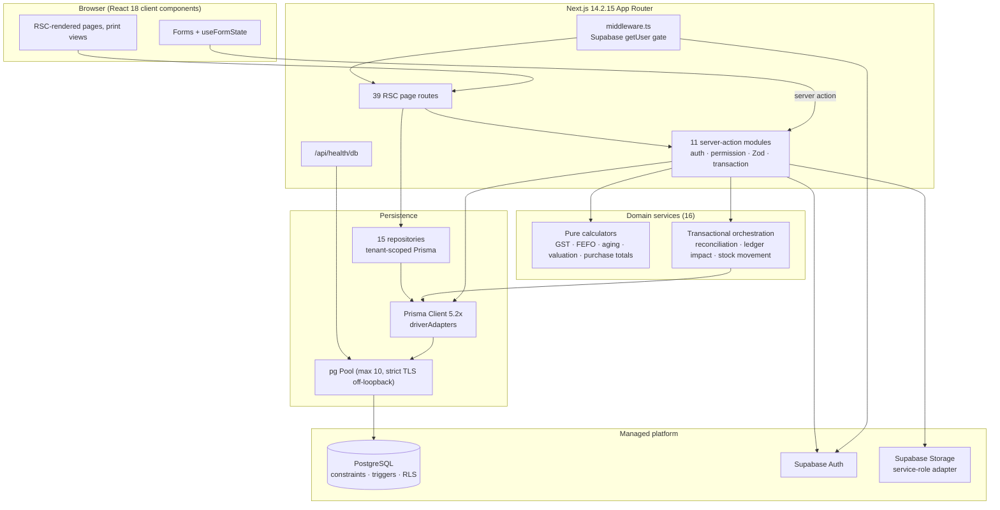
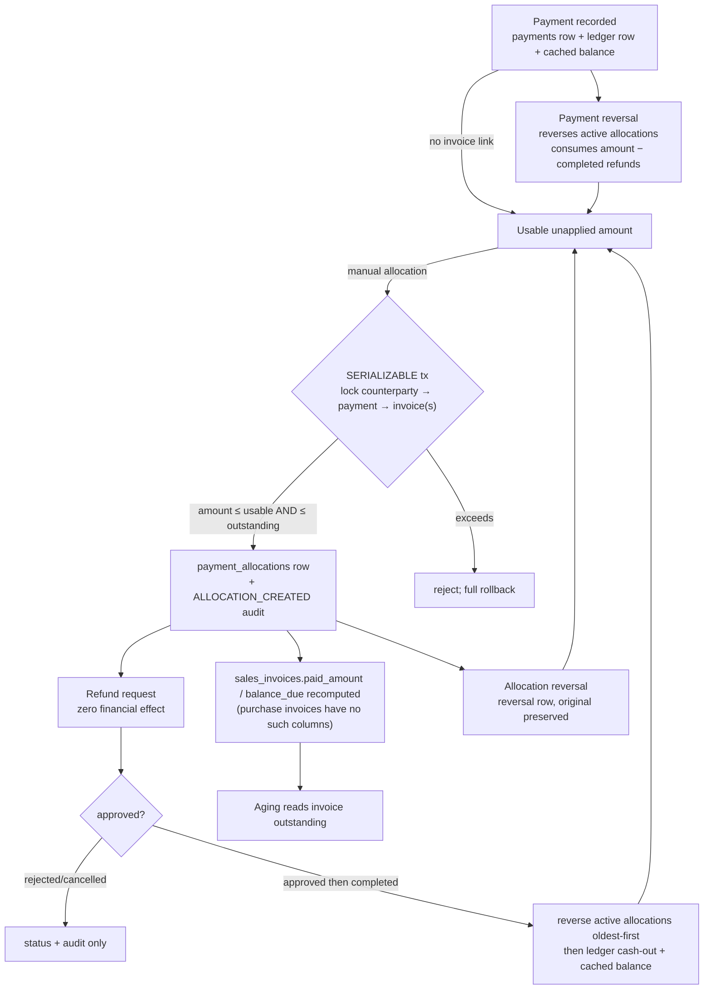
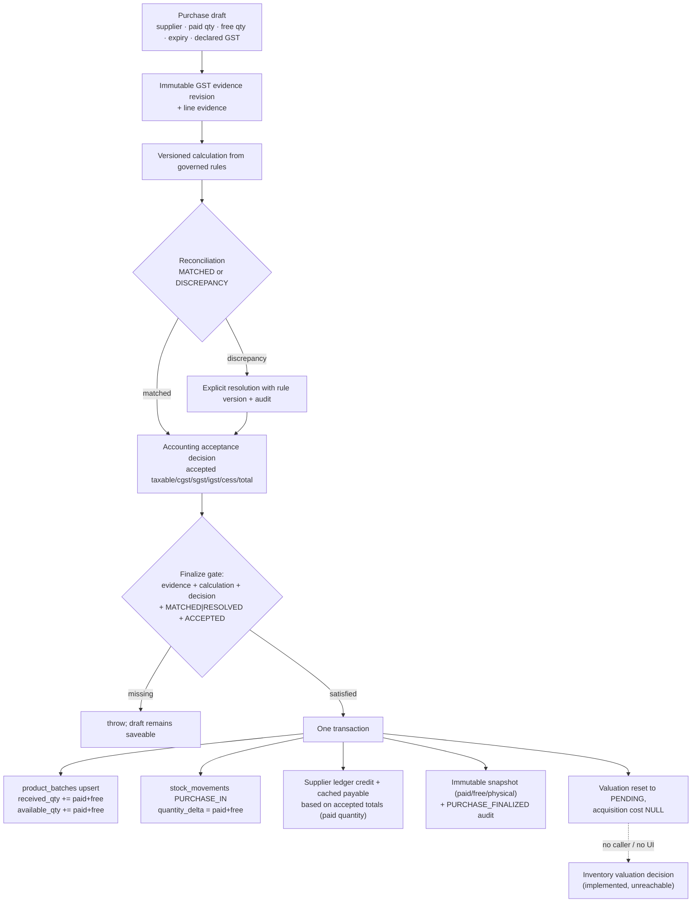
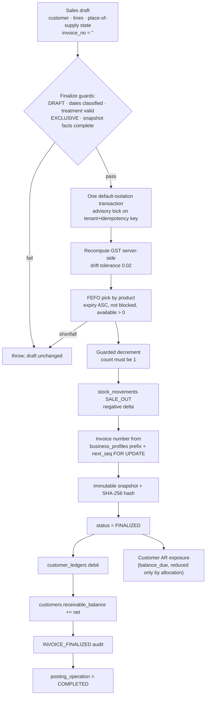
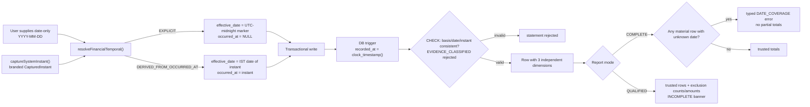
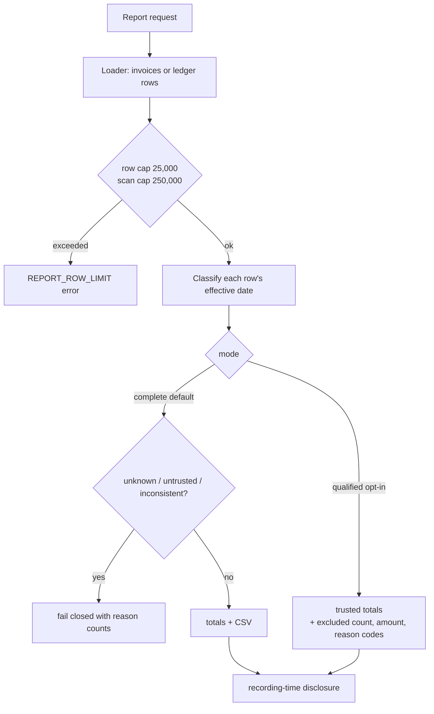

# Pharmnos Lite — Project Engineering Knowledge Dossier

> **Purpose.** One durable reference so that a competent engineer (human or agent) can start an explicitly authorized task in this repository without repeating a full discovery campaign: what the product is, how it is built, how money and stock move, what has actually been proven, and which questions are still open.
>
> **This dossier is not a status report about intentions.** It records repository truth as of HEAD `e47f86e` plus the working tree described in §20.5. Where a project document says something the source does not support, the disagreement is recorded in §21.1 rather than resolved silently.

## How this was produced

| Activity | Performed | Evidence |
|---|---|---|
| Read-only inspection of source, schema, migrations, SQL artifacts, tests, scripts, vault documents | Yes | Citations throughout |
| Direct execution of the offline JavaScript suite | Yes | §18.1 — 640/640, exit 0 |
| TypeScript typecheck executed | No (reported, not re-run) | §18.2 |
| Git history inspection (log, ancestry, show, refs) | Yes | §20 |
| Application/database runtime execution | **No** | No database connected, no migration applied |
| Source, schema, migration, config, or `.env` modification | **None** | §20.5 |
| Git mutation (commit/push/merge/reset/clean/stash/rebase/checkout) | **None** | §20.5 |

**Evidence rule applied.** Executable source and schema outrank tests; tests outrank accepted contracts; accepted contracts outrank implementation reports; implementation reports outrank historical notes. A lower-ranked claim never silently overrides a higher-ranked one.

## Evidence labels

| Label | Meaning |
|---|---|
| **[VERIFIED]** | Confirmed directly from source, schema, migration SQL, tests, or an executed command in this session. |
| **[DOCUMENTED]** | Stated in an existing specification, decision record, acceptance report, or the canonical briefing. Not independently proven here. |
| **[INFERRED]** | A conclusion that follows from verified facts but was not executed or directly observed. |
| **[UNVERIFIED]** | Insufficient evidence exists; includes all runtime database behaviour. |
| **[CONFLICT]** | Repository and documentation (or two parts of the repository) disagree. Nothing is silently resolved. |
| **[OWNER DECISION]** | Requires explicit owner approval; not an engineering choice. |

Status words used with precise, non-interchangeable meanings:

**Designed → Documented → Implemented → Offline verified → Runtime verified → Independently accepted → Production approved.**

A feature may be implemented and offline-verified while remaining runtime-unverified and production-unapproved. Most of this system is in exactly that position.

---

## 1. Executive project overview

**Pharmnos Lite** is a browser-based, multi-tenant pharmacy **wholesale** management application for the Indian market. It is designed to replace the daily operational core of a heavyweight pharmacy ERP — billing, batch-wise stock, expiry control, purchases, ledgers, and business visibility — with a simpler system usable on desktop and mobile. It is explicitly "free-first": there is no pricing, subscription, billing, or payment-provider code in the repository. [VERIFIED] (`package.json` dependency list contains no monetization SDK) + [DOCUMENTED] (`.obsidian-vault/CLAUDE.md:35`)

The system's engineering centre of gravity is **not** inventory CRUD. It is the interaction between three things:

1. **Batch-level pharmaceutical inventory** — every stock quantity belongs to a batch with an expiry date; sales deplete batches first-expiry-first-out.
2. **Bounded AR/AP subledgers** — customer receivables and supplier payables, with payments, allocations, refunds, reversals, and aging.
3. **Financial date semantics** — a rigorous separation between *business date*, *event instant*, and *database recording time*, with fail-closed reporting when provenance is unknown.

A fourth, later-arriving subsystem — **GST evidence and accounting acceptance** — adds an explicit, versioned, auditable chain from supplier-declared tax facts to inventory valuation.

**Architecture in one sentence.** A Next.js App Router application where React Server Components read through server actions and repositories, every mutation runs as a server action in a Prisma transaction with a signed tenant-context GUC, and PostgreSQL supplies structural backstops (constraints, triggers, RLS policies) behind application-level validation. [VERIFIED] (§6, §7)

**Current posture in one sentence.** The implementation is broad and defensively written, offline verification is green, and the project is **not** production-ready: Stage 3 is NO-GO at 10/100, the financial-date acceptance is 6/7 (PARTIALLY VERIFIED) with runtime migration verification unverified, there is no CI, no committed browser E2E suite, and no provider-level backup/recovery evidence. [DOCUMENTED] (§3.3)

---

## 2. Product goals and business model

### 2.1 Users and jobs

| User | Job to be done | Product surface |
|---|---|---|
| Pharmacy wholesale proprietor / manager | Know who owes money, what is expiring, what sold today | `/dashboard`, `/reports/*` [VERIFIED] |
| Billing clerk | Raise a GST sales invoice from batch stock and record receipts | `/billing`, `/billing/new`, `/billing/payments` [VERIFIED] |
| Purchase clerk | Enter a supplier invoice, capture batch/expiry/free quantities, finalize it | `/purchases`, `/purchases/new`, `/purchases/payments` [VERIFIED] |
| Inventory keeper | Maintain products and batches, adjust stock, watch low stock and expiry | `/inventory`, `/inventory/products`, `/inventory/low-stock`, `/inventory/near-expiry` [VERIFIED] |
| Owner / admin | Maintain masters, roles, GST catalog, business profile | `/settings`, `/customers`, `/suppliers`, `/audit` [VERIFIED] |

### 2.2 Business responsibilities actually modelled

- Product master with pharmaceutical attributes: HSN/SAC, drug schedule, pack size, MRP, standard sale rate, purchase rate, reorder level, GST rate. [VERIFIED] (`prisma/schema.prisma:382-412`)
- Batch-level inventory with expiry, received quantity, available quantity, blocking flag. [VERIFIED] (`prisma/schema.prisma:414-441`)
- Purchase invoices with **paid quantity and free quantity kept separate**. [VERIFIED] (`purchase_invoice_items.quantity`, `.free_qty`)
- Sales invoices with per-line GST components and immutable finalized snapshots. [VERIFIED] (§10.3)
- Customer and supplier subledgers plus cached balance projections. [VERIFIED] (§12)
- Payment capture, manual allocation, allocation reversal, refund lifecycle, payment reversal. [VERIFIED] (§11)
- Aging, registers, daybook, statements, GST HSN summary, stock valuation, batch expiry — with CSV export. [VERIFIED] (§16)
- Tenant-scoped audit log for financial and master mutations. [VERIFIED] (§17)

### 2.3 Explicit non-goals

- **No general ledger, no cash book, no bank reconciliation, no double-entry accounting.** Scope is bounded AR/AP only. [DOCUMENTED] (`financial-reconciliation-accounting-invariants.md:85`)
- **No statutory GST filing, e-invoicing, e-way bills, RCM, SEZ/deemed export, UIN, ITC reconciliation, or multi-registration.** These are deferred and must fail closed. [DOCUMENTED] (`.obsidian-vault/CLAUDE.md` GST findings #8)
- **No pricing, subscription, or billing features.** "Free-first" is a product constraint, not a temporary state. [DOCUMENTED]
- **No multi-currency.** The system is INR-only by design; the input contract for rejecting other currencies is unresolved (S-30). [DOCUMENTED]/[OWNER DECISION] (§21.3)
- **No multi-tenant switching inside one session.** Exactly one active membership is required, and more than one is rejected. [VERIFIED] (`tenant-context.ts:101-103`)

### 2.4 Deployment model

Documented target is Vercel Hobby for the Next.js app with Supabase-hosted PostgreSQL, Supabase Auth, and Supabase Storage, all behind provider-independent adapters so that the domain layer does not import Supabase directly. [DOCUMENTED] (`.obsidian-vault/CLAUDE.md` stack table) + [VERIFIED] (`src/adapters/auth`, `src/adapters/storage` are the only Supabase-touching modules)

The configured Supabase project is `lizyjqkckysgvffwcqvb`, region `ap-south-1`, PostgreSQL `17.6.1.171`, organization plan **Free**, project status **INACTIVE** per read-only provider metadata. That is provider identity evidence, not application connectivity evidence. [DOCUMENTED] (`33-recovery-readiness-disposition.md:25-31`)

---

## 3. Project lifecycle and current release posture

### 3.1 Lifecycle model

Working phases are **P1–P7**, all recorded complete on 2026-09-30, followed by **POST-P7 — PRE-PRODUCTION VALIDATION**, which is the current and only active stage. [DOCUMENTED] (`.obsidian-vault/PHASE_TRACKER.md:24-34,49,56-65`)

| Phase | Scope | Recorded status |
|---|---|---|
| P1 | Foundation and architecture (Next.js, Prisma, design system, core routes) | DONE 2026-09-29 |
| P2 | Database, Prisma, multi-tenant core, dashboard shells, auth forms, cloud go-live | DONE 2026-09-29 |
| P3 | Core masters CRUD (products → customers → suppliers) | DONE 2026-09-30 |
| P4 | Purchases and inventory transactions | DONE 2026-09-30 |
| P5 | Billing, ledgers, payments, GST calculation | DONE 2026-09-30 |
| P6 | Dashboard reports, audit views, print templates | DONE 2026-09-30 |
| P7 | Hardening: RLS, storage, CSV coverage, performance, release prep | DONE 2026-09-30 |
| POST-P7 | Pre-production validation (GST modernization, financial integrity, recovery, release gates) | IN PROGRESS |

> **Documentation defect.** The same tracker states POST-P7 is **35%** in the phase table and **60%** in the official-stage line. [VERIFIED] (`PHASE_TRACKER.md:49` vs `:72`) Neither number is production readiness; treat both as workstream estimates. Recorded in §21.1.

### 3.2 The seven status categories, applied

| Capability | Designed | Documented | Implemented | Offline verified | Runtime verified | Independently accepted | Production approved |
|---|---|---|---|---|---|---|---|
| Sales draft → finalize (GST, FEFO, ledger) | Yes | Yes | Yes | Yes (static contracts + mocked action tests) | Partial, bounded, historical disposable target | Bounded ST3-F only (10 points) | **No** |
| Purchase draft → finalize (paid/free, GST gate, valuation PENDING) | Yes | Yes | Yes | Yes | Bounded 17/17 on one disposable target, artifact now stale for current source hash | Conditional (bounded) | **No** |
| Payments / allocation / refund / reversal | Yes | Yes | Yes | Yes | Partial across several disposable runs | **No** (financial acceptance REJECTED) | **No** |
| Financial date semantics (0028) | Yes | Yes | Yes | Yes (640/640, 6/7 criteria) | **No — migration never applied to an authorized target** | **ACCEPT WITH FINDINGS** (read-only review) | **No** |
| Aging (invoice-level) | Yes | Yes | Yes | Yes (boundary + additivity + IST) | **No** | Accepted with findings | **No** |
| GST catalog + purchase evidence chain | Yes | Yes | Yes | Yes (T13/T25/contracts) | Bounded runtime on historical target | No | **No** |
| RLS signed-context policies | Yes | Yes | **Only in the disposable provisioning script, not in migrations** (§7.4) | Policy text asserted by tests | Probed on disposable targets only | No | **No** |
| Backup / restore / DR | Partially | SOP only | Scripts/docs partial | Local data-only restore passed once | Local only | **No** | **No** |
| Browser E2E | Designed | Yes | Campaign-only (Playwright MCP), **not committed** | n/a | One campaign run, conditionally accepted | Conditional | **No** |

### 3.3 Latest recorded verdicts

| Gate | Verdict | Date | Source |
|---|---|---|---|
| Stage 3 final readiness | **NO-GO — 10/100 accepted points** (only ST3-F, bounded sales) | 2026-11-08 | `stage-3-system-readiness/34-final-stage-3-readiness-decision.md:9-38` |
| Financial date semantics final acceptance | **PARTIALLY VERIFIED — 6/7 (86%)**; criterion G runtime **UNVERIFIED** | 2026-11-13 | `financial-date-semantics-final-acceptance-report-2026-11-13.md:9-29,448-460` |
| Independent review of that workstream | **ACCEPT WITH FINDINGS** (no Critical; 2 Major, 5 Minor, all dispositioned) | 2026-11-13 | same report §10 |
| Technical acceptance | Conditional | 2026-11-08 | Stage 3 doc §7 |
| Financial acceptance | **REJECTED** | 2026-11-08 | Stage 3 doc §7 |
| Production / Live Supabase readiness | **NO-GO** | 2026-11-08 | `PHASE_TRACKER.md:75`; Stage 3 doc:242 |

**Do not convert any of these into a broader claim.** In particular: Stage 3 is not "90% done because implementation exists"; the frozen 100-point matrix explicitly refuses to count partial implementation or automated tests as accepted points. [DOCUMENTED] (`34-...:11-14`)

### 3.4 Tracker workstream detail (as recorded, not re-verified)

| Workstream | Recorded | Note |
|---|---|---|
| Code/static validation | 100% COMPLETE | 2026-10-01 |
| Security/RLS/Storage | 100% COMPLETE | Local ordinary-role evidence only; preview evidence ≠ live |
| Preview deployment | 100% COMPLETE | Does not prove Prisma/Supabase connectivity |
| Preview → Prisma → Supabase connectivity | 0% NOT VERIFIED | Prior "fake response" explicitly rejected as evidence |
| Financial E2E infrastructure | 80% IN PROGRESS | Guards, fixtures, dispatcher, injected adapter exist |
| Financial runtime behavior | 40% IN PROGRESS | Scoped scenarios only |
| Purchase atomicity | 40% IN PROGRESS | Bounded |
| Sales/FEFO runtime | **0% BLOCKED** | Scoped assertions passed; full FEFO lifecycle outside campaign |
| Rollback behavior | 60% IN PROGRESS | Immutable-history cleanup deliberately deferred |
| Invoice-sequence rollback | **0% NOT RUN** | No standalone harness or documented rollback contract |
| Payment runtime | 0% BLOCKED | Regressions passed in a bounded run; lifecycle/recovery pending |
| Production Prisma connectivity | 0% NOT VERIFIED | — |
| Backup/restore operational drill | 0% PENDING | — |
| Operational go-live readiness | 0% PENDING | Monitoring, leaked-password protection, support |

[DOCUMENTED] (`PHASE_TRACKER.md:106-133`)

---

## 4. Technology stack and dependency versions

### 4.1 Runtime and framework

| Layer | Actual | Evidence |
|---|---|---|
| Language | TypeScript 5.6 (`^5.6.3`) | `package.json` |
| Node engine | `>=18.18.0` | `package.json` `engines` |
| Package manager | pnpm `9.12.0` (declared `packageManager`) | `package.json` |
| Framework | Next.js **14.2.15**, App Router | `package.json`; `src/app/**/page.tsx` |
| UI | React **18.3.1**, React DOM 18.3.1 | `package.json` |
| Styling | Tailwind CSS 3.4 + shadcn/Radix primitives + CVA + tailwind-merge | `package.json`; `src/components/ui` |
| Forms | react-hook-form 7.53 + `useFormState` server actions | `package.json`; `src/app/**/_form.tsx` |
| Validation | Zod 3.23, per-domain schemas | `src/lib/validation/*` |
| Dates | date-fns 4.1 plus an in-house business-date module | `src/lib/utils/business-date.ts` |
| PDF / print | pdf-lib 1.17 + server-rendered print routes | `src/app/billing/[invoiceId]/print`, `invoice-document.service.ts` |
| Barcode / QR | bwip-js 4.11, qrcode 1.5 | `package.json` |

### 4.2 Data layer

| Layer | Actual | Evidence |
|---|---|---|
| Database | PostgreSQL (Supabase-hosted target; disposable local targets for E2E) | `prisma/schema.prisma` datasource |
| ORM | Prisma Client 5.20–5.22 with `driverAdapters` preview | `prisma/schema.prisma` generator |
| Driver adapter | `@prisma/adapter-pg` 5.22 over an explicit `pg` 8.23 `Pool` | `src/lib/db/prisma.ts:2-5,47-49` |
| Pool | `max: 10`, idle 60 s, connect timeout 60 s, keepAlive | `src/lib/db/prisma.ts:32-39` |
| TLS | `rejectUnauthorized: true` for every non-loopback host; disabled only for `127.0.0.1`/`localhost`/`::1` | `src/lib/db/prisma.ts:31,40` |
| Migration tool | Prisma Migrate (`prisma migrate deploy`), 28 migrations | `prisma/migrations` |

> **Configuration nuance.** `prisma.ts` does not parse `sslmode` from `DATABASE_URL`; TLS is decided solely by host loopback detection. It also returns a **plain `PrismaClient` without an adapter** if `DATABASE_URL` is absent, rather than throwing immediately. [VERIFIED] (`src/lib/db/prisma.ts:19,24-29,34`)

### 4.3 Auth, storage, deployment

| Layer | Actual | Evidence |
|---|---|---|
| Auth | Supabase Auth behind `IAuthAdapter`; `getSession()` + server-side `getUser()` with identity match | `src/adapters/auth/supabase-auth.adapter.ts:143-153` |
| Storage | Supabase Storage behind `IStorageAdapter`; **service-role client used for every storage operation** | `src/adapters/storage/supabase-storage.adapter.ts:9-25` |
| Edge gate | `src/middleware.ts` per-request Supabase server client, redirect on missing user | `src/middleware.ts:20-41` |
| CI | **None.** `.github/` contains only `copilot-instructions.md` | directory listing |
| Git hooks | Only stock `.sample` hooks; nothing active | `.git/hooks` listing |
| Deployment | Vercel Hobby documented; not released | `.obsidian-vault/CLAUDE.md` |

### 4.4 Canonical commands

```text
pnpm dev                     # Next.js dev server
pnpm build                   # prisma generate && next build
pnpm typecheck               # tsc --noEmit
pnpm lint                    # next lint
node --test tests/*.test.mjs # offline regression suite (640 tests at this HEAD)
pnpm test:t13:gstin          # GSTIN length/format suite (ts-node wrapper)
pnpm test:t25:gst-calculation# GST calculator suite
pnpm db:migrate:deploy       # NOT authorized in this task
pnpm financial:e2e:safe      # guarded disposable-target E2E entry
```

There is **no `test` script** in `package.json`; the suite is invoked directly with `node --test`. [VERIFIED] (`package.json`)

---

## 5. Repository structure and important entry points

### 5.1 Top-level layout (abridged to what matters)

```text
E:\PharmnosLite
├── src/
│   ├── middleware.ts                 # edge auth gate
│   ├── app/                          # App Router: 39 page.tsx routes
│   │   ├── _actions/                 # 11 server-action modules (the mutation boundary)
│   │   ├── auth/                     # sign-in / sign-up / forgot-password + auth actions
│   │   ├── billing/                  # sales invoices + customer payments
│   │   ├── purchases/                # purchase invoices + supplier payments
│   │   ├── inventory/                # products, batches, low stock, near expiry
│   │   ├── customers/ suppliers/     # masters + statements
│   │   ├── reports/                  # registers, dues, daybook, GST HSN, valuation, expiry
│   │   ├── settings/ audit/ dashboard/
│   │   └── api/health/db/            # only API route (health probe)
│   ├── domain/services/              # 16 services (pure calc + transactional orchestration)
│   ├── repositories/                 # 15 repositories + factory
│   ├── lib/
│   │   ├── db/                       # prisma, tenant context, signed context, base repo
│   │   ├── utils/                    # business-date, financial-temporal, CSV, display date
│   │   ├── gst/                      # treatment, place-of-supply, rule governance
│   │   ├── validation/               # Zod schemas per domain
│   │   ├── permissions/              # role → permission map
│   │   └── decimal.ts                # in-house bigint decimal
│   ├── adapters/                     # auth + storage provider boundaries
│   ├── components/                   # ui primitives, gst, print, reports, layout, toast
│   └── types/
├── prisma/
│   ├── schema.prisma                 # 39 models, 20 enums, 1,488 lines
│   ├── migrations/                   # 28 migrations, 0001_baseline … 0028_financial_event_dates
│   ├── 01-apply-schema-with-rls.sql  # hosted-path schema + RLS enablement (jwt path)
│   ├── 02-seed-demo-tenant.sql       # demo seed
│   ├── 03-verify-post-seed-counts.sql
│   ├── 04-drift-probe-and-fix.sql
│   ├── 05-rls-tenant-policies.sql    # hosted PostgREST policy set (auth.jwt)
│   ├── 06-storage-bucket-and-policies.sql
│   ├── 07-post-release-index-review.sql
│   ├── 08-sales-gst-facts-and-snapshots.sql
│   └── financial-e2e-*.sql           # generated/review-only E2E artifacts
├── scripts/                          # 50 offline/runtime harnesses (§18.3)
├── tests/                            # 88 .mjs + 3 .ts offline tests
└── .obsidian-vault/                  # canonical specifications, ADRs, reports, daily notes
```

### 5.2 The files that matter most

| Path | Why it matters |
|---|---|
| `prisma/schema.prisma` | Single authoritative data model (39 models, 20 enums) |
| `src/app/_actions/sales.actions.ts` | Sales draft/finalize, **both** customer and supplier payment actions (57 KB) |
| `src/app/_actions/purchases.actions.ts` | Purchase draft/finalize, GST evidence/acceptance, stock adjustment (94 KB) |
| `src/domain/services/financial-reconciliation.service.ts` | Allocation, reversal, refund, payment reversal, locking, retries (39 KB) |
| `src/domain/services/aging-report.service.ts` | Production invoice-level aging and CSV rows |
| `src/domain/services/financial-report-completeness.ts` | COMPLETE/QUALIFIED contract, row caps, error taxonomy, CSV preambles |
| `src/lib/db/tenant-context.ts` | Tenant context resolution + signed GUC establishment |
| `src/lib/db/financial-auth-context.ts` | HMAC context format, TTL, signature verification |
| `src/lib/utils/business-date.ts` | IST business date, branded date, UTC-midnight markers |
| `src/lib/utils/financial-temporal.ts` | Branded instant, temporal union, column projections |
| `src/lib/decimal.ts` | In-house bigint decimal arithmetic |
| `prisma/migrations/0028_financial_event_dates/migration.sql` | Temporal columns, checks, four trigger functions |
| `prisma/migrations/0015_purchase_finalized_immutability/migration.sql` | Finalized purchase immutability trigger |
| `prisma/migrations/0021_reject_finalized_purchase_deletes/migration.sql` | Delete rejection |
| `scripts/financial-e2e-provision-local.mjs` | **Only executable source** of the signed-context RLS functions/policies (§7.4) |

### 5.3 Route inventory (39 pages)

Dashboard; billing (list, new, `[invoiceId]/edit`, `[invoiceId]/print`, payments, payments/new); purchases (list, new, payments, payments/new); inventory (list, products, products/new, products/`[id]`/edit, low-stock, near-expiry); customers (list, new, `[customerId]`, `[customerId]`/edit, statement, statement/print); suppliers (list, new, `[id]`/edit); reports (landing, sales-register, purchase-register, customer-dues, supplier-payables, daybook, gst-hsn-summary, stock-valuation, batch-expiry); settings; audit; auth (sign-in, sign-up, forgot-password); plus public `/` and `/contact`. [VERIFIED] (filesystem glob of `src/app/**/page.tsx`)

---

## 6. Application architecture

### 6.1 Layering as actually implemented

```text
Browser (React client components, useFormState)
   │
   ▼
Next.js App Router (RSC pages)  ──read──►  server actions / repositories
   │
   ├─ Server actions  src/app/_actions/*.actions.ts
   │     assertPostgresConfigured → requireServerTenantContext → requirePermission
   │     → Zod parse → prisma.$transaction(establishTenantContext → domain/service → write)
   │     → audit row → revalidatePath
   │
   ├─ Domain services  src/domain/services/*
   │     pure: GST calculator, FEFO picker, aging, valuation, purchase calculator, monthly stats
   │     transactional: financial reconciliation, ledger impact, stock movement
   │
   ├─ Repositories  src/repositories/*
   │     typed tenant-scoped Prisma access; some mutation methods intentionally throw
   │
   └─ Prisma Client + @prisma/adapter-pg + pg Pool
         ▼
      PostgreSQL: constraints, triggers, RLS policies
```

| Layer | Responsibilities | Deliberate constraints |
|---|---|---|
| Presentation | RSC pages, client forms, print templates | Server-rendered; no client-side data fetching layer |
| Action boundary | Auth, permission, parse, transaction, revalidate | Every mutating action calls `assertPostgresConfigured` and `requirePermission` |
| Domain | Business rules and exact arithmetic | Pure services are unit-tested; some transactional services bypass repositories |
| Persistence | Typed access, tenant scoping | `PaymentRepository`/`CustomerLedgerRepository`/`SupplierLedgerRepository` mutation methods **throw by design** [VERIFIED] (`payment.repository.ts:63-79`, `ledger.repository.ts:57-76,222-241`) |
| Platform | DB, context, decimals, temporal, validation | Fail-closed guards |
| Adapters | Auth and storage providers | Only modules importing Supabase |

### 6.2 Mutation lifecycle (canonical shape)

1. `assertPostgresConfigured("<action>")` — refuses when `DATABASE_URL` is absent or still points at a local Supabase stack, with one narrow documented exception for guarded disposable E2E targets. [VERIFIED] (`src/lib/db/prisma.ts:91-98`, `:63-88`)
2. `requireServerTenantContext()` — Supabase session → `users.external_id` → exactly one active membership → role + permission list. [VERIFIED] (`tenant-context.ts:66-147`)
3. `requirePermission(ctx, PermissionAction.x)` — throws before any database work. [VERIFIED] (`tenant-context.ts:29-36`)
4. Zod parse of `FormData` into a typed payload; field errors returned as `ActionResult`. [VERIFIED] (e.g. `sales.actions.ts:1090-1097`)
5. `prisma.$transaction(async (tx) => { await establishTenantContext(tx, ctx); ... })` — sets the signed `pharmnos.auth_context` with `set_config(..., true)` (transaction-local). [VERIFIED] (`tenant-context.ts:45-56`)
6. Domain/service writes business rows **and** the audit row in the same transaction. [VERIFIED] (e.g. `financial-reconciliation.service.ts:322-350`)
7. Post-commit `revalidatePath(...)` refreshes affected RSC routes; suppressed in E2E mode. [VERIFIED] (`sales.actions.ts:1232-1237`)

### 6.3 Transaction and idempotency patterns

| Pattern | Where | Detail |
|---|---|---|
| Advisory transaction lock by `(tenant, idempotency key)` | sales finalize, purchase finalize/finalize-GST, stock adjustment | `pg_advisory_xact_lock(hashtextextended(...))` [VERIFIED] (`sales.actions.ts:651-658`, `purchases.actions.ts:1393-1400`) |
| Posting-operation ledger | `sales_posting_operations`, `purchase_posting_operations` | `PROCESSING` → `COMPLETED` with `request_payload_hash`; replay returns the committed entity, hash mismatch throws [VERIFIED] (`sales.actions.ts:659-680,704-712,1019-1032`) |
| Unique `(tenant_id, idempotency_key)` + payload hash | payments, allocations, refunds, reversals | replay must match the hash or fail [VERIFIED] (§11) |
| Deterministic row locks | reconciliation | counterparty → payment → invoices sorted by id, `FOR UPDATE` [VERIFIED] (`financial-reconciliation.service.ts:127-195,289-292`) |
| Serializable + bounded retry | reconciliation only | 5 attempts, retry on `P2034`/`P2010`+`40001`, linear backoff 20 ms × attempt [VERIFIED] (`financial-reconciliation.service.ts:94-114`) |
| Guarded conditional update | stock depletion, purchase status claim | `updateMany` with `where available_qty >= deduct` / `where status = 'DRAFT'` and `count !== 1` throw [VERIFIED] (`sales.actions.ts:826-832`, `purchases.actions.ts:1643-1652`) |

> **Not uniform.** Payment creation uses a plain `$transaction` with no isolation level and no retry; it relies on a `FOR UPDATE` lock on the counterparty row plus the unique idempotency index. [VERIFIED] (`sales.actions.ts:1122,1148,1216-1219`)

### 6.4 Error handling

- Actions return a discriminated `ActionResult<T>`; expected validation problems become field errors, unexpected errors become a message. [VERIFIED] (e.g. `sales.actions.ts:1243-1246`)
- Provider auth errors are surfaced verbatim to the client; forgot-password deliberately does not enumerate accounts. [VERIFIED] (`auth.actions.ts:310-314`)
- Report loaders throw typed `ReportUnavailableError` codes and never render partial totals in COMPLETE mode. [VERIFIED] (`financial-report-completeness.ts:70-109,253-278`)
- There is **no** global error boundary convention beyond Next.js defaults; database-down pages degrade with an explicit banner via `isPostgresConfigured()`. [VERIFIED] (`dashboard/page.tsx:65-69`)

### 6.5 Where business rules are (and are not) enforced

| Rule | Enforced in | Gap |
|---|---|---|
| GST treatment supported | `validateGstTreatment` at draft and finalize | — |
| Tax mode EXCLUSIVE | Actions (purchases at draft, sales at **finalize only**) | An inclusive sales draft is creatable but unfinalizable [VERIFIED] (`sales.actions.ts:530` vs `:699-701`) |
| HSN approved classification | Product create/edit + invoice finalize | A product may be created with empty HSN, which later blocks finalization [VERIFIED] (`masters.actions.ts:53`) |
| Stock availability | FEFO aggregate shortfall at finalize | Per-batch choice made in the UI is **ignored** by the server [VERIFIED] (§10.4) |
| Product deletion safety | Action guard only | `ProductRepository.delete` hard-deletes with no check [VERIFIED] (`product.repository.ts:44-47`) |
| Finalized sales immutability | E2E provisioning script only | **No migration-level trigger** (§8.5) |

---

## 7. Authentication and tenant isolation

### 7.1 Authentication chain

1. **Edge gate.** `src/middleware.ts` creates a per-request Supabase server client and calls `supabase.auth.getUser()` — the JWT is re-validated, not merely read from a cookie. Unauthenticated or errored requests are redirected to `/auth/sign-in`; a missing environment pair also redirects rather than allowing through. Public prefixes are `/`, `/contact`, and `/auth`, so **every** `/auth/*` route bypasses the gate. [VERIFIED] (`src/middleware.ts:4-46`)
2. **Adapter verification.** `authAdapter.getCurrentSession()` calls `getSession()` and then `getUser()`, and rejects the session unless `verifiedUser.id === session.user.id`. [VERIFIED] (`supabase-auth.adapter.ts:143-153`)
3. **Tenant resolution.** `getServerTenantContext()` maps `external_id → users → active memberships → role → permissions`. Exactly one active membership is required; zero throws "no active tenant membership", more than one throws "ambiguous active tenant memberships". [VERIFIED] (`tenant-context.ts:66-139`)
4. **Metadata backfill.** `setAppMetadataTenantId` writes `tenant_id` into Supabase `app_metadata` best-effort; failures are swallowed so page loads never break. [VERIFIED] (`tenant-context.ts:109-115`)

### 7.2 Authorization model

- **Roles** (`SystemRole`): `ADMIN`, `BILLING`, `INVENTORY`, `MANAGER`. [VERIFIED] (`schema.prisma:21-26`)
- **Permissions** (`PermissionAction`): 33 discrete actions covering users, roles, business profile, products, HSN catalog, GST rates, customers, suppliers, purchases, purchase GST, invoices, payments, inventory, batches, ledgers, reports, audit. [VERIFIED] (`schema.prisma:28-73`)
- **Mapping**: `ADMIN` = all; `BILLING` = 10 invoice/payment actions; `INVENTORY` = 12; `MANAGER` = 11 read/report actions. [VERIFIED] (`src/lib/permissions/constants.ts:3-44`)
- **Enforcement**: `requirePermission` throws before database access; reviewed mutating actions call it. [VERIFIED] (`masters.actions.ts:129-130`, `sales.actions.ts:645,1099`)

> **[CONFLICT] — duplicated role→permission map with drift.** A second independent copy lives in `src/app/auth/_actions/auth.actions.ts:29-69` and is what sign-up/onboarding persists into `role_permissions`. Its MANAGER set omits `manage_hsn_catalog`, while `src/lib/permissions/constants.ts:31-43` grants it. Newly onboarded tenants therefore receive a different MANAGER permission set than the constants file describes. Recorded in §21.1.

### 7.3 The signed database context

`financial-auth-context.ts` implements a compact, signed, short-lived assertion:

```text
v1|<subjectId>|<tenantId|"">|<expiryUnixSeconds>|<nonceHex32>.<hmacSha256Hex>
```

| Property | Value | Evidence |
|---|---|---|
| Version | `v1` | `financial-auth-context.ts:3` |
| TTL | **60 seconds** | `:4,26` |
| Nonce | 16 random bytes hex (32 chars), regex-validated | `:27,48-50` |
| Algorithm | HMAC-SHA256 | `:21-23` |
| Secret | `DATABASE_AUTH_CONTEXT_SIGNING_SECRET`, **minimum 32 chars**, else throws | `:6-12` |
| Node verification | length check then `timingSafeEqual`, then expiry | `:53-61` |
| Injection | `set_config('pharmnos.auth_context', …, true)` — transaction-local | `tenant-context.ts:45-56` |
| Subject-only bootstrap | Resolving the user's membership writes the context with an **empty tenant** first | `tenant-context.ts:75-81` |

**Transaction scoping is structural, not conventional.** `establishTenantContext` accepts only `Prisma.TransactionClient` and always passes `is_local = true`; there is no call site outside a transaction. [VERIFIED] (`tenant-context.ts:45-56`; call sites e.g. `sales.actions.ts:479-480,650`, `ledger-impact.service.ts:137-138`)

> **Caveat that must not be overstated.** The Node verifier is constant-time. The PostgreSQL verifier in the disposable provisioning script compares the hex signature with plain `<>`, not in constant time. [VERIFIED] (`scripts/financial-e2e-provision-local.mjs:308-309`)

### 7.4 RLS reality — the most important tenancy finding in this dossier

Three different tenant-context conventions coexist, and they do **not** all apply to the same access path:

| Artifact | Tables | Predicate | Executable? |
|---|---|---|---|
| `prisma/01-apply-schema-with-rls.sql:794-813` | 20 hosted tables | **No policies at all** — enables RLS = default deny; grants to `authenticated` | Yes (hosted paste path) |
| `prisma/05-rls-tenant-policies.sql:30-41,260-319` | 19 tables | `auth.jwt() -> 'app_metadata' ->> 'tenant_id'` (PostgREST gateway) | Yes — the file self-documents that it is **not** the direct Prisma path |
| `prisma/migrations/0020_.../migration.sql:11-17` | `purchase_supplier_documents` only | `current_setting('request.jwt.claim.tenant_id', true)` | Yes — the **only** RLS policy in the entire migration history |
| `scripts/financial-e2e-provision-local.mjs:189-236,284-402` | all tenant tables | `pharmnos_private.verify_auth_context()` → `financial_context_tenant_id()`, with `ENABLE` **and `FORCE` ROW LEVEL SECURITY**, policies `TO <runtime_role>` | Yes — **but only inside the disposable E2E provisioner** |
| `prisma/financial-e2e-*.review.sql` | — | Describes the same signed-context policies | **No** — review-only, fully commented, excluded from artifacts |

Consequences, stated plainly:

1. **A plain `prisma migrate deploy` on a fresh database creates no RLS policies** (except the single 0020 policy) and does not enable RLS. [VERIFIED] (grep of `prisma/migrations` for `CREATE POLICY` → one match; for `ENABLE ROW LEVEL SECURITY` → none)
2. **The signed-context RLS that the application's direct Prisma path is documented to rely on exists only in `scripts/financial-e2e-provision-local.mjs`.** There is no committed production-runnable artifact that installs `pharmnos_private.verify_auth_context`, `financial_context_tenant_id`, or the `FORCE RLS` policies. [VERIFIED]
3. **`FORCE ROW LEVEL SECURITY` appears only in the disposable provisioner and the q14 review artifact**, not in `01-apply-schema-with-rls.sql` or `05-rls-tenant-policies.sql`. Standard PostgreSQL behaviour is that a table owner bypasses RLS unless it is forced, so the hosted path cannot be assumed to constrain the application's own role. [VERIFIED]/[INFERRED]
4. **Some transactional write paths never establish the database context at all** — product/master creation, GST catalog writes, invoice-document writes, and `StockMovementService` scope purely by explicit `tenant_id` columns. On a restricted-role target whose policies require `financial_context_tenant_id()`, those writes would be denied. Whether they are denied in practice is **UNVERIFIED** (no database was used). [VERIFIED] (absence of `establishTenantContext` in `masters.actions.ts:133-173`, `gst-catalog.actions.ts:95`, `invoice-document.actions.ts:180`, `stock-movement.service.ts:165`)

> **This corrects a claim in the previous untracked draft**, which said the direct Prisma path consumes the signed GUC "and RLS policies enforce tenant isolation" as if that were the repository-wide configuration. It is not: it is the disposable-target configuration. Recorded as conflict #5 in §21.1.

### 7.5 Known privileged/bypass paths

| Path | What it bypasses | Evidence |
|---|---|---|
| Supabase **service role** client in the auth adapter | PostgREST authz/RLS for `inviteUser`, `setAppMetadataTenantId` | `supabase-auth.adapter.ts:118-128,205-217,246-253` |
| Supabase **service role** for every storage operation | Storage RLS | `supabase-storage.adapter.ts:9-25` |
| `onboardNewTenant()` writes tenants/profiles/roles/users/memberships with bare `prisma` and **no** tenant context | Nothing scopes this first-tenant bootstrap | `auth.actions.ts:116-199` |
| Synthetic E2E session installer | Replaces real Supabase Auth, guarded by four env flags + exact loopback target match, blocked in production | `supabase-auth.adapter.ts:19-60,132-142` |

No `$queryRawUnsafe`/`$executeRawUnsafe` exists in `src/`. [VERIFIED] (grep: 0 matches)

### 7.6 PostgREST gateway — a separate, unexercised trust boundary

The hosted policy artifact uses `auth.jwt()` `app_metadata.tenant_id` for a PostgREST-style authenticated gateway. The direct Prisma/runtime path uses the signed GUC instead. The Stage 3 record explicitly states the gateway path "was not exercised in this campaign" and that forged-claim resistance applies only to the direct path. [DOCUMENTED] (`34-...:29,73-89`) This is an open acceptance gap, not a resolved equivalence.

---

## 8. Database schema and migration architecture

### 8.1 Verified counts

| Item | Count | Evidence |
|---|---|---|
| Prisma models | **39** | `schema.prisma` (1,488 lines) |
| Prisma enums | **20** | same |
| Migrations | **28**, `0001_baseline` … `0028_financial_event_dates` | `prisma/migrations` directory |
| Page routes | **39** `page.tsx` | filesystem glob |
| Server-action modules | 11 | `src/app/_actions` |
| Domain services | 16 | `src/domain/services` |
| Repositories | 15 + `index.ts` factory | `src/repositories` |
| Offline test files | 88 `.mjs` + 3 `.ts` = **91** | `tests` directory |
| Executed offline tests | **640** | §18.1 |

### 8.2 Model clusters

| Cluster | Models | Purpose |
|---|---|---|
| Tenancy & identity (6) | `tenants`, `users`, `memberships`, `roles`, `role_permissions`, `business_profiles` | Membership-mediated access; seller identity, state, invoice prefixes and sequences |
| Masters (4) | `products`, `product_batches`, `customers`, `suppliers` | Product attributes, batch quantities/expiry, counterparty terms and cached balances |
| Purchases (5) | `purchase_invoices`, `purchase_invoice_items`, `purchase_supplier_documents`, `purchase_posting_operations` | Draft → FINALIZED; paid vs free; supplier invoice identity; immutable snapshot; posting idempotency |
| GST catalog (4) | `hsn_sac_catalog`, `hsn_sac_catalog_history`, `gst_rate_rules`, `gst_rate_rule_history` | Versioned, approval-gated classification and rate catalog |
| Purchase GST evidence (8) | `purchase_gst_evidence_revisions`, `purchase_gst_line_evidence`, `purchase_gst_calculations`, `purchase_gst_accounting_decisions`, `purchase_gst_reconciliation_events`, `purchase_gst_reconciliation_event_lines`, `inventory_valuation_decisions`, `inventory_valuation_adjustments` | Immutable evidence → versioned calculation → acceptance → append-only reconciliation → explicit valuation |
| Sales (3) | `sales_invoices`, `sales_invoice_items`, `sales_posting_operations` | Draft → FINALIZED; seller/customer/product/tax snapshots; hash; idempotency |
| Money (6) | `payments`, `payment_receipt_sequences`, `payment_allocations`, `allocation_reversals`, `payment_refunds`, `payment_reversals` | One counterparty per payment; usable-amount consumption; sequenced receipt numbers |
| Inventory, ledgers, audit (4) | `stock_movements`, `customer_ledgers`, `supplier_ledgers`, `audit_logs` | Movement trail; running ledger balances; append-only audit |

### 8.3 Key schema conventions

- `snake_case` tables/columns; Prisma models map directly.
- Every business table carries `tenant_id`; composite uniques `(tenant_id, id)`, `(tenant_id, invoice_no)` are standard.
- Money is `Decimal(14,2)`; quantities are **integers** (`Int`) on batches and movements; tax rates `Decimal(7,4)`; acquisition cost `Decimal(20,4)`.
- Append-only patterns: audit logs, GST evidence revisions, reconciliation events, ledger rows — corrections are new rows.
- Only `sales_invoices` carries `paid_amount`/`balance_due`; `purchase_invoices` has neither, which forces supplier outstanding to be recomputed. [VERIFIED] (`schema.prisma` invoice models)

### 8.4 Migration inventory

| Migration | Subject |
|---|---|
| `0001_baseline` | Full initial schema |
| `0002`–`0007` | Purchase line GST model, GST treatment facts, GST catalog/rules, sales & purchase rule snapshots, governance controls |
| `0008`–`0011` | HSN governance integrity, purchase line acceptance, valuation pending state, valuation decision history |
| `0012`–`0013` | Payment integrity, payment permission backfill |
| `0014`–`0016` | Supplier invoice uniqueness (raw, then trimmed) |
| `0015` | Finalized purchase immutability trigger |
| `0017`–`0020` | Invoice artifacts (snapshot/PDF), supplier documents, document lifecycle metadata, supplier-document RLS + active guard |
| `0021` | Reject finalized purchase deletes |
| `0022` | Financial reconciliation foundation (allocations, reversals, refunds, ledger columns) |
| `0023`–`0026` | Multiple allocation reversals, reconciliation audit enum values, receipt sequence, more audit events |
| `0027` | Refund lifecycle statuses + lifecycle guard trigger |
| `0028` | Financial event dates: effective date, occurrence instant, recorded-at model |

**Migration behaviour that must be understood before any deployment decision:**

- Migrations are **not** a complete provisioning story. Hosted provisioning documented in ADR 0001 uses four idempotent SQL files pasted into the Supabase SQL editor (`01`, `04`, `02`, `03`); note that the RLS policy file `05` is **not** in that documented paste sequence, while `01` enables RLS with no policies. [VERIFIED] (`decisions/0001-supabase-sql-editor-paste-workaround.md`) + [DOCUMENTED]
- Only 0020 adds an RLS policy; no migration enables RLS generally (§7.4).
- Sales-finalized immutability triggers exist only in the E2E provisioner, not in migrations (§8.5).

### 8.5 Database-level guarantees that actually exist

| Guarantee | Mechanism | Evidence |
|---|---|---|
| Finalized purchase invoice immutability | `prevent_finalized_purchase_mutation()` BEFORE UPDATE/DELETE, with a narrow controlled-finalization window; `ERRCODE 42501` | `0015/migration.sql:1-225` |
| Finalized purchase delete rejection | `reject_finalized_purchase_delete()` BEFORE DELETE on invoice and items | `0021/migration.sql:1-60` |
| Refund status transitions | `payment_refunds_lifecycle_guard` BEFORE INSERT/UPDATE enforcing the exact allowed transitions | `0027/migration.sql:92-214` |
| Recording-time assignment and protection | `assign_financial_recorded_at`, `protect_financial_recorded_at` | `0028/migration.sql:195-269` |
| Invoice business-date immutability | `guard_invoice_financial_dates` | `0028/migration.sql:271-317` |
| Refund date facts | `guard_refund_financial_dates` | `0028/migration.sql:319-381` |
| Cross-row sum limits | **Impossible with CHECK constraints**; enforced by locks + Serializable transactions | `invariants.md:55-67` |
| Available stock = Σ movements | **No DB object exists** — the cached `available_qty` is authoritative and untied to the movement trail | grep: no such trigger/constraint |

> **Material asymmetry.** Finalized **purchases** are protected by database triggers; finalized **sales** are protected only by repository code and the disposable provisioning script. `sales-invoice.repository.ts:106-122` explicitly warns its guard protects repository updates only, "not direct Prisma or SQL writes". [VERIFIED]

### 8.6 Naming the three date/time concepts early

| Concept | Column family | Meaning |
|---|---|---|
| Business date | `effective_date DATE`, `due_date_business DATE` | The IST calendar date an event belongs to |
| Event instant | `occurred_at TIMESTAMPTZ(3)` | A genuine system instant captured at the operation boundary |
| Recording time | `recorded_at`, `finalized_recorded_at`, `requested_recorded_at`, `completed_recorded_at` (all `TIMESTAMPTZ(3)`) | `clock_timestamp()` at statement execution **inside an open transaction, before commit** |

Full treatment in §14.

---

## 9. Monetary arithmetic and financial data representation

### 9.1 The in-house decimal

`src/lib/decimal.ts` (226 lines) implements an exact decimal over a **bigint coefficient plus a normalizing scale**. This is *not* a fixed-point 18-decimal integer.

```ts
class Decimal { readonly coefficient: bigint; readonly scale: number }
```

| Aspect | Behaviour | Evidence |
|---|---|---|
| Representation | `{ coefficient: bigint, scale: number }`, trailing zeros stripped, zero collapses to scale 0 | `decimal.ts:18-27,82-89` |
| `DECIMAL_CALCULATION_SCALE` | **18** — but only the default *division* scale, not a storage contract | `decimal.ts:4,137-141` |
| Construction | `Decimal.from()`: Decimal passthrough; bigint → scale 0; **number → stringified first** (no binary-float arithmetic); objects via `toString()`; strings via strict regex with exponent support | `decimal.ts:91-103,29-44` |
| Addition/subtraction | Aligns scales, exact bigint math | `decimal.ts:119-130` |
| Multiplication | Exact coefficient product; scales add | `decimal.ts:132-135` |
| Division | `divide(value, scale = 18, mode = "HALF_UP")`; divide-by-zero throws; result re-normalized | `decimal.ts:137-154` |
| Rounding modes | `HALF_UP` = ties **away from zero**; `DOWN` = toward zero; `NONE` = bigint truncation | `decimal.ts:46-64` |
| Comparison | Scale-aligned exact comparison | `decimal.ts:182-189` |
| Serialization | `toString()` (trimmed), `toFixed(scale, mode)` (padded) | `decimal.ts:191-199` |
| Helpers | `decimalOrZero`, `sumDecimals`, `roundHalfUp`, `roundDown`, `roundSection170NearestRupee` | `decimal.ts:206-226` |

`Decimal.from(number)` stringifies first (`String(value)`), which avoids binary-float multiplication but means a float that has already lost precision is accepted at face value. [VERIFIED] (`decimal.ts:94-97`)

### 9.2 JS floating point is not fully eliminated

The exact-arithmetic invariant holds inside the GST calculators and reconciliation service, but **not end-to-end**:

| Path | Still numeric | Evidence |
|---|---|---|
| Inventory valuation math | `number` arithmetic, epsilon compare `0.0001` | `inventory-valuation.service.ts:37-45,111,130-134` |
| Accepted-GST accumulation | `reduce((sum, v) => sum + …)` | `inventory-valuation.actions.ts:128-133` |
| Purchase header totals | taken from client-submitted strings via `Number(...)` at draft | `purchases.actions.ts:713-717` |
| GST HSN summary accumulation | raw JS number accumulation | `exports.actions.ts:471-486` |
| Cess check | `Number(accepted.amounts.cess ?? 0) === 0` | `purchase-gst-reconciliation.service.ts:108-111` |
| All money writes to Prisma | converted with `.toNumber()` before persistence into `Decimal(14,2)` | e.g. `payment.repository.ts:182`, `gst-calculator.service.ts:86` |

`parseFloat` appears nowhere in `src/`. [VERIFIED] (grep: 0 matches)

> **Consequence to keep in mind.** Computation is exact; the *boundary* is numeric. Values are persisted as JavaScript numbers into 2-decimal columns, so the database performs the final rounding. This is safe for paise-scale commerce but is not the same claim as "arbitrary-precision money end-to-end". Do not describe it as the latter.

### 9.3 Rounding policy differs by document type

| Document | Rounding | Evidence |
|---|---|---|
| Sales invoice line | Taxable and each tax component rounded to 2 dp HALF_UP | `gst-calculator.service.ts:202-294` |
| Sales grand total | `round_off_applied` computed as a **2 dp** rounding difference, i.e. effectively zero; there is no rupee rounding | `gst-calculator.service.ts:198-200,308-322` |
| Purchase line | Component tax halved then each half rounded 2 dp HALF_UP | `purchase-calculator.service.ts:88-95` |
| Purchase commercial total | `roundCommercialInvoiceTotal` rounds the subtotal to **whole rupees** and books the difference as `round_off` | `purchase-calculator.service.ts:149-166` |

This asymmetry is intentional-or-at-least-implemented, and it is one of the reasons a "consistent rounding" review item remains open. [DOCUMENTED] (`.obsidian-vault/CLAUDE.md` GST findings #5)

### 9.4 How money is stored and projected

- Money columns: `Decimal(14,2)`. Acquisition cost: `Decimal(20,4)`. Tax rates: `Decimal(7,4)`. [VERIFIED] (`schema.prisma`)
- `gst_amount` persisted on sales lines is recomputed as `cgst+sgst+igst+cess` rounded to 2 dp, so the aggregate always equals its components. [VERIFIED] (`gst-calculator.service.ts:76-93`)
- No database CHECK constrains monetary values to be positive, except specific fund-flow checks added with the reconciliation tables. [VERIFIED] (`0027/migration.sql:58-63`)

---

## 10. Product, purchase, sales, and inventory workflows

### 10.1 Product creation

`createProductAction` — `src/app/_actions/masters.actions.ts:111-186`.

| Step | Behaviour | Evidence |
|---|---|---|
| Parse | `productCreateSchema` = edit schema + `batches.min(1).max(100)` | `masters.schemas.ts:113-115` |
| Permission | `create_product` | `masters.actions.ts:129-130` |
| HSN classification | If HSN is supplied it must match an **APPROVED, active, currently-effective** `hsn_sac_catalog` row; an empty HSN is allowed and defers the block to finalization | `requireApprovedProductClassification`, `:48-71,134` |
| Schedule | Required (`ScheduleClass` enum) | `masters.schemas.ts:14-23,100-102` |
| MRP / GST rate | MRP required ≥ 0; GST rate optional ≥ 0 — **no whitelist, no cross-check against `gst_rate_rules`** | `masters.schemas.ts:105-106` |
| Units | No UOM column exists; only free-text `pack_size` | `schema.prisma:382-412` |
| Batch rows | `received_qty` and `available_qty = received_qty`; `is_blocked: false`; **no `stock_movements` row is written for opening stock** | `masters.actions.ts:154-171` |
| Product delete | Soft deactivate, blocked if any non-blocked batch or any batch with `available_qty > 0`; audited | `masters.actions.ts:255-332` |

> **[CONFLICT] — batch creation passes fields that do not exist.** `createProductAction` builds each batch with `manufacture_date` and `created_by` and calls `product_batches.createMany`. The `product_batches` model has **no `manufacture_date` and no `created_by` column** (`schema.prisma:414-441`; zero occurrences of `manufacture_date` anywhere in `prisma/`). Prisma rejects unknown arguments at runtime, so product creation *with batches* is expected to fail even though typecheck passes (the payload is a variable, so TypeScript excess-property checking does not fire). Runtime behaviour is **[INFERRED]**, not executed. Recorded in §21.1.

### 10.2 Purchase workflow

**Draft** — `createPurchaseDraftAction` (`purchases.actions.ts:584-826`):

1. Zod: per-line `PurchaseInvoiceLineCreateSchema` (product, batch no, expiry, **quantity**, **free_qty**, MRP, purchase rate, sale rate, discount %, GST rate, declared tax facts) and header `PurchaseInvoiceCreateSchema` (supplier, supply facts, ≥1 line). [VERIFIED] (`purchases.schemas.ts:159-217`)
2. Permission `create_purchase`; GST treatment validated; `tax_mode` must be `EXCLUSIVE` (rejected here, not at finalize). [VERIFIED] (`:621-634`)
3. Tenant checks on supplier, products, and any referenced batch (product + batch number pair). [VERIFIED] (`:655-694`)
4. Writes: `purchase_invoices` (status `DRAFT`, totals **from the form**), `purchase_invoice_items` with `inventory_valuation_status: "PENDING"`, GST evidence revision + line evidence + calculation + reconciliation event, optional supplier document. [VERIFIED] (`:699-816`)
5. **No stock, no ledger, no batch creation at draft.** [VERIFIED]

**Finalization** — `finalizePurchaseAction` (`purchases.actions.ts:1380-1924`). Order inside one transaction:

| # | Step | Evidence |
|---|---|---|
| 1 | Permission `finalize_purchase`; idempotency key defaults to `purchase:<id>:finalize` | `:1387-1389` |
| 2 | `establishTenantContext` + advisory xact lock | `:1391-1400` |
| 3 | Load invoice; only `DRAFT` may proceed | `:1401-1412` |
| 4 | Business date provenance required (`effective_date`, `due_date_business`) | `:1413-1415` |
| 5 | GST treatment + `EXCLUSIVE` tax mode | `:1416-1422` |
| 6 | Supplier-invoice duplicate pre-check (tenant + supplier + number) | `:1426-1439` |
| 7 | Re-resolve governed GST line rules | `:1445` |
| 8 | **GST gate**: evidence + calculation + accounting decision present, reconciliation `MATCHED`/`RESOLVED`, acceptance `ACCEPTED` — otherwise throw | `:1473-1484` |
| 9 | Every line must carry its immutable acceptance snapshot; accepted line sums must reconcile to the decision | `:1517-1565` |
| 10 | Payable/tax totals derived from the **accepted** snapshot | `:1579-1590` |
| 11 | Canonical payload hash + posting-operation idempotency | `:1591-1661` |
| 12 | Conditional status claim `WHERE status='DRAFT' AND gst_record_version=…`, count check | `:1643-1652` |
| 13 | Per line: persist accepted tax + `line_total`; **reset** recoverable ITC / non-recoverable GST / acquisition cost to `NULL`, valuation back to `PENDING` | `:1671-1693` |
| 14 | `product_batches.upsert` on `(tenant, product, batch_no)`, incrementing **physical** quantity | `:1694-1725` |
| 15 | `stock_movements.create` `PURCHASE_IN`, `quantity_delta = physicalQty` | `:1728-1762` |
| 16 | Invoice numbering from `business_profiles.purchase_prefix/purchase_next_seq FOR UPDATE` | `:1764-1790` |
| 17 | Immutable snapshot (paid qty, free qty, physical qty) | `:1792-1827` |
| 18 | Invoice → `FINALIZED` + snapshot + PDF status | `:1835-1854` |
| 19 | Supplier balance lock; `supplier_ledgers` credit; `suppliers.payable_balance` increment | `:1865-1889` |
| 20 | Audit `PURCHASE_FINALIZED` | `:1891-1901` |

**Paid vs free — the accepted policy, verified in code:**

```text
physicalQty = quantity + free_qty        → posted to batch received/available and to stock_movements
payable / purchase value                → derived from accepted invoice totals computed on quantity only
snapshot                                → retains paid, free, and physical quantities
```

[VERIFIED] (`purchases.actions.ts:1673-1675,1712-1713,1731,1749,1807-1808,1567-1572`) + [DOCUMENTED] (`34-...:44-51`)

### 10.3 Sales workflow

**Draft** — `createSalesDraftAction` (`sales.actions.ts:419-597`):

| Step | Behaviour | Evidence |
|---|---|---|
| Parse | Per-line and header Zod schemas; header requires customer, treatment, tax mode, place-of-supply state, invoice date, terms, ≥1 line | `sales.schemas.ts:22-58` |
| Auth | `create_invoice` | `:456-457` |
| Treatment / place of supply | Unsupported treatment rejected; UNKNOWN place of supply blocks the draft | `:459-477` |
| Tenant checks | Customer, and batch must belong to the product and tenant | `:482-505` |
| Writes | `sales_invoices` with `status: DRAFT`, **`invoice_no: ""`**, `tax_data_status: "UNVERIFIED_DRAFT"`, `paid_amount: 0`, `balance_due = grand_total`; plus `sales_invoice_items` with GST components | `:517-581` |

**Finalization** — `finalizeSalesInvoiceAction` (`sales.actions.ts:628-1078`):

| # | Step | Evidence |
|---|---|---|
| 1 | Strict idempotency-key regex; `finalize_invoice` permission; payload hash | `:633-646` |
| 2 | `establishTenantContext` + advisory xact lock | `:649-658` |
| 3 | Posting-operation replay check (hash mismatch / completed / in-progress) | `:659-680` |
| 4 | Draft guard; **business dates must be classified**; treatment valid; `EXCLUSIVE` only | `:682-701` |
| 5 | Posting operation inserted as `PROCESSING` (before stock work) | `:704-712` |
| 6 | Re-resolve governed GST rules and **recompute all totals server-side** | `:720-734` |
| 7 | Place of supply from the persisted code | `:730-738` |
| 8 | Snapshot-completeness gate (`canMarkSalesInvoiceComplete`) | `:740-754` |
| 9 | Totals-drift guard vs stored gross/tax/net, tolerance 0.02 | `:755-764` |
| 10 | Persist per-line tax components + product/batch/expiry snapshots | `:766-795` |
| 11 | FEFO candidate load: `available_qty > 0`, not blocked, `expiry_date >= now()` or null | `:797-812` |
| 12 | FEFO allocate; shortfall throws; **guarded decrement** with `count !== 1` throw; `stock_movements` `SALE_OUT` with negative delta | `:815-849` |
| 13 | Invoice number from `business_profiles.invoice_prefix/next_seq FOR UPDATE` (`PREFIX-00001`) | `:854-880` |
| 14 | Customer balance lock → immutable snapshot + SHA-256 hash → status `FINALIZED` | `:883-980` |
| 15 | `customer_ledgers` debit row with running balance → cached `receivable_balance` increment → audit `INVOICE_FINALIZED` | `:982-1017` |
| 16 | Posting operation → `COMPLETED`; revalidate; on error, poll posting operation for replay | `:1019-1076` |

**Money path verified:** line gross → discount → taxable → CGST+SGST (intra) or IGST (inter) → line total → invoice totals → `round_off` → `net_amount`; `paid_amount` starts at 0 and `balance_due = net_amount`. [VERIFIED] (`gst-calculator.service.ts:202-326`, `sales.actions.ts:517-545`)

### 10.4 Inventory: the source of truth question

**The authoritative availability number is the cached counter `product_batches.available_qty`.** `stock_movements` is an append-only audit trail that is **never aggregated** to derive availability anywhere in `src/`. [VERIFIED] (grep for aggregation over `stock_movements` returns none; all read paths use `available_qty`)

| Consumer | What it reads | Evidence |
|---|---|---|
| Inventory page product totals | `p.batches.reduce(… available_qty)` | `inventory/page.tsx:120,270` |
| Batch tab | `available_qty`, `received_qty` | `inventory/page.tsx:400-401` |
| Product list (with batches) | `batches: { where: { available_qty: { gt: 0 } } }` | `product.repository.ts:71` |
| Low stock | Σ `available_qty` vs `reorder_level` | `product.repository.ts:96,107-109` |
| FEFO candidates | `available_qty: { gt: 0 }` | `product-batch.repository.ts:119` |
| Near expiry / valuation | `available_qty` | `product-batch.repository.ts:136,169` |
| Billing FEFO picker UI | `available_qty` | `billing/new/_form.tsx:141,202` |

Writers: purchase finalization upsert-increments; sales finalization guarded-decrements; stock adjustment guarded-increments/decrements. **No trigger or constraint ties `available_qty` to Σ `quantity_delta`.** [VERIFIED]

> **UI defect.** The inventory movement table renders `m.delta_qty`, but the column is `quantity_delta`. Movements therefore display as 0/undefined in that view. [VERIFIED] (`inventory/page.tsx:468` vs `schema.prisma` `stock_movements.quantity_delta`)

### 10.5 FEFO behaviour — and its gaps

`allocateBatchesFefo` (`fefo-batch.service.ts:38-102`):

- Order: preferred batch ids first → batches below `min_expiry_date` last → expiry ascending (null expiry treated as +∞) → `created_at` ascending. [VERIFIED] (`:48-65`)
- Filters: `is_blocked` excluded unless `skip_blocked === false`; `available_qty <= 0` excluded. [VERIFIED] (`:67-74`)
- Allocation: greedy `min(required, available)`; shortfall computed and thrown by the caller. [VERIFIED] (`:76-101`, `sales.actions.ts:818-820`)
- Quantities are rounded to whole units (`Math.round`). [VERIFIED] (`fefo-batch.service.ts:43`)

| Gap | Detail | Evidence |
|---|---|---|
| Selected batch is ignored | The draft stores the UI-chosen `batch_id`, but finalization allocates by **product** and never consults it; `sales_invoice_items.batch_id` is not rewritten, while `stock_movements.batch_id` records the batches actually picked | `sales.actions.ts:797-852` vs `:771-795` |
| Free quantity not depleted | Sales `free_qty` is accepted and persisted but FEFO uses `line.quantity` only | `sales.schemas.ts:27`, `sales.actions.ts:816` |
| Expiry filtering lives in the action | The service only *sorts* expired batches last; the exclusion is the query predicate `expiry_date >= now() OR null` | `sales.actions.ts:804` vs `fefo-batch.service.ts:55-60` |
| No test coverage of FEFO | `fefo-batch.service.ts` has **no test file**; only a string assertion on the action error message exists | `tests/` grep |

### 10.6 `StockMovementService` is bypassed

`src/domain/services/stock-movement.service.ts` implements inbound/outbound invariants (blocked-batch rejection, product/batch match, positive-integer rounding). It is exported through `src/domain/services/index.ts` but **no workflow action uses it**; sales and purchase actions re-implement partial equivalents inline, and the purchase stock-adjustment path performs **no `is_blocked` check at all**. [VERIFIED] (service: `:104-113,179-201`; actions: `sales.actions.ts:800-832`, `purchases.actions.ts:1995-2018`)

---

## 11. Payments, allocations, refunds, and reversals

All five operations live in two places: payment *creation* in `sales.actions.ts` (both counterparties), and everything else in `financial-reconciliation.service.ts`.

### 11.1 Payment creation

| Aspect | Customer receipt | Supplier payment |
|---|---|---|
| Function | `createCustomerPaymentAction` `sales.actions.ts:1080-1247` | `createSupplierPaymentAction` `sales.actions.ts:1249-1416` |
| Schema | `CustomerPaymentCreateSchema` (`sales.schemas.ts:64-72`) | `SupplierPaymentCreateSchema` (`:76-84`) |
| Permission | `create_payment` | same |
| Rows | `payments` (`PAYMENT_RECEIVED`, receipt no) + `customer_ledgers` credit + cached balance overwrite | `payments` (`PAYMENT_MADE`) + `supplier_ledgers` debit + cached balance overwrite |
| Auto-allocation | **None** — no `payment_allocations` row; ledger `invoice_id` is explicitly `null` | same |
| Amount handling | Payment row stores the **full** amount; cached balance is `before − amount` and **may go negative** (unapplied credit) | same on the payable side |
| Concurrency | `FOR UPDATE` on the counterparty balance row; unique idempotency index with `P2002` replay | same |
| Isolation/retry | Plain `$transaction`, no isolation level, no retry loop | same |

[VERIFIED] (`sales.actions.ts:1122,1148,1173-1219,1350-1388`)

> **[CONFLICT] — stale documented claim.** The Stage 3 record states "current action paths reject customer/supplier overpayments before persistence" (`34-...:66-69`). Current source does the opposite: it records the payment in full and lets the cached balance go negative, which is consistent with the later owner-approved account-level payment policy and with the test "customer and supplier overpayments remain recorded as unapplied balances". The Stage 3 sentence predates that change. Recorded in §21.1.

> **Input-contract gap.** `decimalFromString` rejects only `n < 0`, so a **zero-amount payment passes validation**, and no database CHECK requires `payments.amount > 0`. [VERIFIED] (`purchases.schemas.ts:72-84`; migrations: only the one-counterparty and date checks exist)

### 11.2 Allocation

`allocatePayment` — `financial-reconciliation.service.ts:276-354`.

```text
1. assertPostgresConfigured → caller already did auth                                      (reconciliation.actions.ts:48-60)
2. SERIALIZABLE transaction, up to 5 attempts on P2034/40001                               (service:100-114)
3. establishFinancialContext (signed GUC)                                                   (service:281)
4. idempotency lookup by (tenant, key); payload-hash mismatch throws; match → replay        (service:282-288)
5. discover payment counterparty (no lock)                                                  (service:289)
6. LOCK counterparty row FOR UPDATE                                                         (service:127-139)
7. LOCK payment row FOR UPDATE                                                              (service:141-164)
8. LOCK target invoice row FOR UPDATE (ids de-duped and sorted)                             (service:183-195)
9. verify payment.counterparty == invoice.counterparty == expectedCounterparty              (service:293-311)
10. usable = amount − Σ(allocations − reversals) − ΣcompletedRefunds − paymentReversal      (service:242-246)
11. outstanding = invoice.net_amount − Σ active allocations                                 (service:318)
12. reject if allocation > outstanding or > usable                                          (service:319-320)
13. insert payment_allocations (idempotency key, payload hash, allocated_by, date/instant)   (service:321-334)
14. insert audit_logs ALLOCATION_CREATED                                                    (service:335-350)
15. for sales only: recompute paid_amount/balance_due                                       (service:250-262)
```

Key properties:

- **Exactly-once consumption arithmetic.** Usable subtracts each consumption class exactly once, and every allocation total subtracts its own reversals. [VERIFIED] (`service:197-233`)
- **Purchase invoices have no paid/balance columns**, so allocation does not update them; supplier outstanding is always recomputed. [VERIFIED]
- **No cached counterparty balance mutation** on allocation — asserted by test. [VERIFIED] (`tests/financial-reconciliation-foundation-contract.test.mjs:153-165`)

### 11.3 Allocation reversal

`reverseAllocation` — `service:356-406`.

- Reverse the full remaining amount `allocation.amount − Σreversals`; reject if already fully reversed. [VERIFIED] (`:372-374`)
- Preserves the original allocation row and its date; the reversal carries its own `effective_date`/`occurred_at`. [VERIFIED] (`:381,386,390`)
- Lock order: counterparty → payment → invoice; **there is no `FOR UPDATE` on the allocation row itself and no re-read after the payment lock.** Exactly-once therefore rests on Serializable + the idempotency key, not on a second guard. [VERIFIED] (`:367-380`)
- Audit `ALLOCATION_REVERSED`; sales balance recomputed. [VERIFIED] (`:393-403`)
- Restores usable credit exactly once because usable always subtracts reversals. [VERIFIED] (`:203,222,245`; test `financial-reconciliation-temporal-runtime.test.mjs:346`)

### 11.4 Refund lifecycle

Statuses: `REQUESTED → APPROVED → COMPLETED`, with `REJECTED` and `CANCELLED` terminal alternatives. The database enforces the exact transition set via `payment_refunds_lifecycle_guard`. [VERIFIED] (`schema.prisma:153-159`; `0027/migration.sql:92-214`)

| Transition | Financial effect | Evidence |
|---|---|---|
| Request | **None.** Asserts refundable amount, inserts `REQUESTED`, writes `REFUND_REQUESTED` audit. No ledger, no balance, no allocation. | `service:515-584` |
| Approve | Re-checks refundable; status + audit only | `service:629-646` |
| Reject / Cancel | Status + audit only | `service:633-646` |
| Complete | Requires `APPROVED`; re-asserts refundable; **locks and reverses the payment's active allocations oldest-first** with per-allocation idempotency keys; then marks `COMPLETED`, writes the cash-out ledger row, and updates the cached balance | `service:684-858` |

Completion detail worth knowing: it reverses allocations **inline** rather than calling `reverseAllocation`, one captured instant is reused for every row, and the reconciliation ledger rows are written with `balance: 0` (unlike payment-creation rows, which store a running balance). [VERIFIED] (`service:735,738,759-793,821,846`)

### 11.5 Payment reversal

`reversePayment` — `service:860-978`.

```text
counterparty lock → payment lock → read allocations (unlocked) → lock all sales invoices (sorted) → lock all purchase invoices (sorted)
```

- Active allocations are those with `amount − Σreversals > 0`; each is reversed for its full remaining amount with key `<key>:allocation:<id>`. [VERIFIED] (`:878-920`)
- `payment_reversals.amount = payment.amount − ΣcompletedRefunds` — the surviving usable portion, so refunded money is not double-consumed. [VERIFIED] (`:885-891`)
- Structural once-only: unique `(tenant_id, payment_id)`; plus `(tenant_id, idempotency_key)` and payload-hash comparison. [VERIFIED] (`schema.prisma:1362-1363`; `0022:117-120`)
- Ledger + cached balance restored in the same transaction. [VERIFIED] (`:933-975`)

This matches the owner-approved special lock ordering (common counterparty/payment locks first, then discover and deterministically lock the invoice set, then reread). [DOCUMENTED] (`invariants.md:55-67`)

### 11.6 Retry and concurrency utilities

| Utility | Behaviour | Evidence |
|---|---|---|
| `isRetryable` | `P2034`, or `P2010` with SQLSTATE `40001` | `service:94-98` |
| `retryTransaction` | 5 attempts, Serializable, linear 20 ms × attempt backoff | `service:100-114` |
| Lock ordering | counterparty → payment → invoices sorted ascending by id; all sales locks before all purchase locks | `service:127-195,184,883-884,708-719` |

**Unverified:** concurrent double-reversal with different idempotency keys, and real serialization-failure behaviour, have never been executed against a database in the evidence reviewed. [UNVERIFIED]

### 11.7 Deliberately unreachable code in this subsystem

- `runReconciliationMutation` (`service:980-988`) — **no caller** in `src/`.
- `financial-temporal-classification.ts` — imported by **no application module**, only by tests. Classification is therefore not wired into any report; report trust uses the simpler basis check in `financial-report-completeness.ts`. [VERIFIED] (grep)
- `payments.invoice_id` and `payment_allocations.legacy_unallocated` — columns exist but are never written by TypeScript. [VERIFIED]

---

## 12. Customer AR and supplier AP

### 12.1 Definitions (owner-approved vocabulary)

```text
Gross customer receivable   = outstanding finalized sales-invoice exposure + approved debit adjustments
Unapplied customer credit   = valid receipts/credits not allocated to sales invoices
Net customer position       = gross customer receivable − unapplied customer credit
Gross supplier payable      = outstanding finalized purchase-invoice exposure + approved credit adjustments
Unapplied supplier advance  = valid supplier payments not allocated to purchase invoices
Net supplier position       = gross supplier payable − unapplied supplier advance
```

[DOCUMENTED] (`financial-reconciliation-accounting-invariants.md:9-23`)

### 12.2 Where each number actually comes from

| Number | Computation | Source of truth |
|---|---|---|
| Customer invoice exposure | `sales_invoices.balance_due` (> 0 rows); set to `net_amount` at finalization and thereafter maintained only by the reconciliation service | Stored projection [VERIFIED] (`sales.actions.ts:517-545`; `aging-report.actions.ts:49,53,64`) |
| Supplier invoice exposure | `net_amount − Σ(allocation.amount) + Σ(reversal.amount)` | Always recomputed [VERIFIED] (`aging-report.service.ts:188-198`) |
| Unapplied customer credit | `usable payment − allocations − refunds − reversal` across the payment set | Derived [VERIFIED] |
| Cached `customers.receivable_balance` | Written by finalize (+), payment (overwrite, may go negative), refund completion (+), payment reversal (+), ledger recompute | **Projection, not authority** |
| Cached `suppliers.payable_balance` | Purchase finalize (+), payment (overwrite), refund completion (+), payment reversal (+), ledger recompute | **Projection, not authority** |

Ledger authority: `LedgerRepository.getBalance` = Σ debit − Σ credit over `customer_ledgers` (supplier mirrored). [VERIFIED] (`ledger.repository.ts:108-119,275-279`)

### 12.3 The customer/supplier asymmetry, stated exactly

| | Customer | Supplier |
|---|---|---|
| Invoice columns | `paid_amount`, `balance_due` exist and are recomputed on each allocation | Neither column exists |
| Aging reads | stored `balance_due` | recomputed `net_amount − allocations` |
| Allocation effect on aging | immediate (row updated) | implicit (recomputation) |
| Test that pins it | `aging-report-actions.test.mjs` | asserts `"balance_due" in where === false` |

[VERIFIED] (`schema.prisma` invoice models; `aging-report.actions.ts:49-64`)

**Risk this creates.** A stale or externally edited `sales_invoices.balance_due` silently shifts customer aging, while supplier aging cannot drift that way. Conversely, unallocated customer receipts do **not** reduce aging — aging shows gross invoice exposure, not net position, until receipts are allocated. This is a presentation/policy gap, not an arithmetic error, and is recorded in §21.2. [VERIFIED]/[OPEN]

### 12.4 Aging buckets

Five **exclusive** buckets, by business due date:

```text
days <= 0  → current      (not yet due, or due today)
days <= 30 → d30          (1–30)
days <= 60 → d60          (31–60)
days <= 90 → d90          (61–90)
otherwise  → over90       (> 90)
```

[VERIFIED] (`aging-report.service.ts:116-123`; `ledger.repository.ts:176-180,346-350`)

- Days = IST business date of the as-of instant minus the invoice's `due_date_business` marker. [VERIFIED] (`aging-report.service.ts:105-114,141`)
- Rows with no trusted due date go to an explicit **`unclassified`** amount and count; they are **not** guessed and **not** silently dropped. [VERIFIED] (`:157-159`)
- `total = classified + unclassified`; completeness is `QUALIFIED` when any unclassified row exists. [VERIFIED] (`:100,183`)
- **Aging does not fail closed on an unclassified due date**; it qualifies. The legacy repository path *does* throw, but it has no production call sites. [VERIFIED] (`ledger.repository.ts:13-15,174,344`; `aging-report-fail-closed.test.mjs:315-324`)
- The legacy summary surface maps `current_30 = current + d30`, `bucket_31_60 = d60`, `bucket_61_90 = d90`, `bucket_over_90 = over90`. [VERIFIED] (`ledger.repository.ts:195-200,365-370`)

The aging contract is settled and closed; see §13.6 and §21.4 for the freeze instruction.

---

## 13. Financial reconciliation specifications and accepted decisions

### 13.1 The document set

`.obsidian-vault/specs/financial-reconciliation/` holds 23 documents. The ones an engineer must read, in order:

| Document | Role |
|---|---|
| `financial-reconciliation-accounting-decision-pack.md` | Full decision rationale A–O |
| `financial-reconciliation-policy-matrix.md` | Policy → implementation mapping |
| `financial-reconciliation-scenario-matrix.md` | **S-01 … S-38** expected outcomes |
| `financial-reconciliation-decision-log.md` | Owner approvals (A–O + 13 scenario resolutions) |
| `financial-reconciliation-engineering-plan.md` | Delivery plan |
| `financial-reconciliation-accounting-invariants.md` | **Approved equations, lock protocol, aging boundaries** |
| `financial-reconciliation-architecture.md` | Architecture view |
| `financial-reconciliation-closure-report.md` | Closure claims (historical) |
| `financial-reconciliation-gap-analysis.md` | Gap register |
| `financial-reconciliation-test-report.md` | Test evidence (historical) |
| `financial-date-semantics-*` (design, implementation, audit, review, cleanup, final acceptance) | Temporal workstream and its correction history |
| `scenario-evidence-classification-2026-11-09.md` | Per-scenario evidence classification |
| `independent-engineering-gap-investigation-2026-11-09.md` | Independent investigation |

### 13.2 Approved equations (authoritative)

```text
Invoice outstanding       = finalized invoice exposure + approved adjustments − valid allocations
Payment usable amount     = source payment amount − valid allocations − completed refunds/reversals
Unapplied customer credit = usable customer receipts/credits not allocated to sales invoices
Unapplied supplier advance= usable supplier payments not allocated to purchase invoices
Net customer position     = gross customer receivable − unapplied customer credit
Net supplier position     = gross supplier payable − unapplied supplier advance
```

[DOCUMENTED] (`invariants.md:25-34`)

### 13.3 The 13 owner-approved scenario resolutions

All dated 2026-11-08. Approval establishes **policy**, not implementation or runtime acceptance.

| Scenario | Approved outcome | Implemented? |
|---|---|---|
| S-07 | Unallocated valid customer payment ₹400 → unapplied credit ₹400 | Implemented [VERIFIED] |
| S-08 | Unallocated valid customer payment ₹1,000 → unapplied credit ₹1,000 (owner-resolved from the earlier zero-credit conflict) | Implemented [VERIFIED] |
| S-09 | Unallocated ₹1,500; multi-invoice allocation is atomic | Implemented [VERIFIED] |
| S-10 | Unallocated payments totalling ₹700 → credit ₹700; two allocations from one payment | Implemented [VERIFIED] |
| S-22 | Credit ₹500; allocate ₹400 → ₹100 left; reversal restores ₹500 | Implemented [VERIFIED] |
| S-23 | Credit ₹800; allocate ₹400 → ₹400 left; reversal restores ₹800 | Implemented [VERIFIED] |
| S-24 | Credit ₹500; allocate ₹300 → ₹200 left; reversal restores ₹500 | Implemented [VERIFIED] |
| S-31 | Supplier payments ₹750 + ₹1,250 → advance ₹2,000 | Implemented [VERIFIED] |
| S-32 | Supplier payment ₹3,000 → advance ₹3,000; one payment / many invoices | Implemented [VERIFIED] |
| S-33 | Supplier payment ₹750 → advance ₹750; partial settlement traceable | Implemented [VERIFIED] |
| S-37 | Invoice face ₹2,000; allocation ₹1,100; outstanding ₹900; advance attributable is zero | Implemented [VERIFIED] |
| S-18 | **Commercial** customer credit note — not a GST credit note. Pending excess changes no posted balance; approval settles the invoice and turns approved excess into linked, audited unapplied credit; rejection changes nothing | **Not implemented** [OWNER DECISION + FEATURE GAP] |
| S-38 | Commercial supplier debit adjustment: ₹2,000 − ₹100 = ₹1,900 (not ₹1,350; no invented ₹550). Approval + audit required before posted balance changes | **Not implemented** [OWNER DECISION + FEATURE GAP] |

[DOCUMENTED] (`financial-reconciliation-decision-log.md:9-33`; `financial-reconciliation-scenario-matrix.md:17-48`; `scenario-evidence-classification-2026-11-09.md`)

### 13.4 Unresolved policy questions — do not decide unilaterally

| ID | Question | Current state |
|---|---|---|
| **S-27** | `Cheque` is a supported `PaymentMode`, but the scenario expects it to be **rejected before persistence**. Either retain Cheque and correct the fixture, or disallow Cheque and define handling of existing records. | **[OWNER DECISION]** |
| **S-30** | Explicit currency input validation versus rejection of an unexpected `currency` field at the INR-only boundary. Today the payment schemas do not model currency at all; an extra field would be discarded by Zod object parsing. | **[OWNER DECISION]** |

[DOCUMENTED] (`independent-engineering-gap-investigation-2026-11-09.md:43-44`; `scenario-matrix.md:37,40`)

### 13.5 Concurrency protocol (accepted, and implemented)

For allocation creation, refund completion, allocation reversal, payment reversal, and multi-invoice allocation:

```text
1. Validate tenant and party ownership.
2. Lock parents in ascending (tenant_id, parent_kind, parent_id) order.
3. Re-read allocations, refunds/reversals, adjustments after the locks.
4. Recompute usable payment and invoice outstanding.
5. Reject if either requested amount exceeds the recomputed remainder.
6. Write allocation/reversal/refund and update projections in one transaction.
7. Commit; any failure rolls the whole operation back.
```

[DOCUMENTED] (`invariants.md:55-67`) + [VERIFIED] implementation mapping in §11.

Two honest qualifications:

- PostgreSQL `CHECK` constraints **cannot** enforce cross-row `SUM()` invariants; the guarantee is the lock protocol plus Serializable isolation. [DOCUMENTED]/[VERIFIED]
- The *real* runtime behaviour of the retry loop and lock contention has never been executed in the evidence reviewed. [UNVERIFIED]

### 13.6 Deliberate non-goals of this workstream

- No GL, cash book, or double-entry. [DOCUMENTED] (`invariants.md:85`)
- No automatic FIFO allocation: allocation is manual by decision A. [DOCUMENTED]
- No editing or deleting posted financial rows: correction is reversal + repost. [DOCUMENTED] (`decision-log.md:20-21`)
- No inference of historical classification from `created_at`, midnight timestamps, host timezone, or payment type. [DOCUMENTED] (`financial-date-semantics-and-ledger-date-model-design-2026-11-09.md`)

### 13.7 Final acceptance history — accepted with findings, frozen

This subsection exists because the workstream's paperwork once contradicted the code, and a future engineer must not repeat either the claim or the "fix".

**What was claimed.** The 2026-11-10 cleanup report's Finding 3 asserted that `agedReceivablesTotals` and `agedPayablesTotals` had been changed to `bucket_over_90: buckets.d90 + buckets.over90`, and that `tests/financial-ist-timezone.test.mjs` had been updated from `9` to `24`. It further implied a 6/6 complete result.

**What the repository shows.** [VERIFIED]

```ts
// src/repositories/ledger.repository.ts:198 and :368
bucket_over_90: buckets.over90,
```

```js
// tests/financial-ist-timezone.test.mjs — fixture: { current: 3, d30: 7, d60: 11, d90: 15, over90: 9, total: 45 }
bucket_over_90: 9,
```

**What actually happened to the formula.** It was added in `e1b61f8` (turn 47) and reverted in `4acfdbd` (turn 51), both inside an unmerged agent-checkpoint lineage with no ancestry on `main` (§20.2).

**Why the proposed formula is wrong.** It double-counts the 61–90 range:

```text
current_30 = 10, bucket_31_60 = 11, bucket_61_90 = 15, bucket_over_90 = 15 + 9 = 24
sum = 60   ≠   total = 45
```

The existing exclusive implementation is internally consistent with the approved invariant that names the boundaries `current/not-yet-due, 1–30, 31–60, 61–90, >90`. [DOCUMENTED] (`invariants.md:79`)

**Status of the paperwork.** Finding 3 is **retracted**; the earlier 6/6 verdict is **withdrawn**; the report is marked corrected; the transient checkpoint history is recorded rather than denied. [VERIFIED] (working-tree modification to the cleanup report) + [DOCUMENTED] (acceptance report §7.1)

**Latest scored result:** 6/7 (86%) — criteria A–F PASS (with E scoped), **G runtime migration/trigger verification UNVERIFIED**. Independent read-only review verdict: **ACCEPT WITH FINDINGS**, no Critical, 2 Major + 5 Minor all dispositioned. Offline evidence: 640/640 tests, typecheck 0, lint 0, schema validation 0 with placeholders, generated-schema check 0, provisioning guard PASS, both diff checks 0. [DOCUMENTED] (acceptance report §8, §10, §11)

**Freeze instruction.** Treat this workstream as accepted with findings and frozen. Do **not** reopen aging calculations, and do **not** repeat the acceptance campaign, without specific regression evidence. Do **not** claim runtime migration verification has occurred. This acceptance is **not** production readiness.

---

## 14. Financial date semantics and temporal architecture

### 14.1 Three independent dimensions

| Dimension | Column(s) | Meaning | Producer |
|---|---|---|---|
| **Business date** | `effective_date DATE`, `due_date_business DATE` | IST calendar date the event belongs to | User-supplied date-only, or derived from a captured instant |
| **Event instant** | `occurred_at TIMESTAMPTZ(3)` | A genuine system instant at the operation boundary | `captureSystemInstant()` only |
| **Recording time** | `recorded_at`, `finalized_recorded_at`, `requested_recorded_at`, `completed_recorded_at` | `clock_timestamp()` at statement execution inside the open transaction | Database triggers |

[VERIFIED] (`financial-temporal.ts`; `0028/migration.sql`)

### 14.2 Business timezone rules

- Canonical timezone: **`Asia/Kolkata`**. [VERIFIED] (`business-date.ts:1`) + embedded literally in the 0028 CHECK constraints (`0028:93,125,157,189`)
- A date-only value is a **branded `YYYY-MM-DD` string**, validated as a real calendar date (rejects `0000-`, round-trips the ISO slice). [VERIFIED] (`business-date.ts:49-64`)
- To Prisma it becomes a **UTC-midnight marker** (`new Date("YYYY-MM-DDT00:00:00.000Z")`) for `@db.Date`; reading it back **requires** that exact marker and throws otherwise. [VERIFIED] (`business-date.ts:66-77`)
- No time is invented for a date-only input, and **no 5:30 shift is applied to storage**. [VERIFIED]
- `businessDateToday()` derives the IST date by `Intl` formatting of the instant, not by adding an offset. [VERIFIED] (`business-date.ts:79-90`)
- Consequence: browser, machine, server, database, and VPN timezones cannot determine a business date, because the only derivation path goes through the `Intl` formatter configured with `Asia/Kolkata`.

### 14.3 Type-level enforcement

```ts
type CapturedInstant = Date & { readonly [capturedInstantBrand]: true };

type FinancialTemporalInput =
  | { readonly businessDate: BusinessDate; readonly occurredAt?: never }
  | { readonly occurredAt: CapturedInstant; readonly businessDate?: never };
```

- The brand symbol is not exported, so only `captureSystemInstant()` can mint an instant; a bare `Date` — including a UTC-midnight database marker — does not type-check as one. [VERIFIED] (`financial-temporal.ts:8-15,49-54`)
- `resolveFinancialTemporal` rejects at runtime: non-objects, arrays, `Date` instances, unknown keys, both-or-neither fields, malformed date strings, invalid instants. [VERIFIED] (`:60-103`)
- `eventTemporalFields` throws if an event has no captured instant, so allocations/reversals cannot be backdated by a caller. [VERIFIED] (`:126-134`)
- Result carries `effectiveDateBasis` ∈ {`EXPLICIT`, `DERIVED_FROM_OCCURRED_AT`} plus `legacyTimestamp` for the old timezone-less columns. [VERIFIED] (`:28-41`)

### 14.4 Migration 0028 — strictly additive

| Table group | Columns added |
|---|---|
| `sales_invoices`, `purchase_invoices` | `effective_date DATE`, `due_date_business DATE`, `finalized_recorded_at TIMESTAMPTZ(3)` |
| `payments`, `customer_ledgers`, `supplier_ledgers` | `effective_date`, `effective_date_basis`, `occurred_at`, `recorded_at` |
| `payment_allocations`, `allocation_reversals`, `payment_reversals` | `effective_date`, `occurred_at`, `recorded_at` (no basis) |
| `payment_refunds` | `requested_business_date`, `requested_occurred_at`, `requested_recorded_at`, `completed_effective_date`, `completed_effective_date_basis`, `completed_occurred_at`, `completed_recorded_at` |
| Enum | `FinancialDateBasis { EXPLICIT, DERIVED_FROM_OCCURRED_AT, EVIDENCE_CLASSIFIED, AMBIGUOUS, UNCLASSIFIED }` |

[VERIFIED] (`0028/migration.sql:1-59`)

**Constraints (13 checks across 9 tables):**

- Shape: `(NULL, NULL)` or `(date, EXPLICIT|DERIVED_FROM_OCCURRED_AT)` or `(NULL, AMBIGUOUS|UNCLASSIFIED)`. [VERIFIED] (`:64-84,97-116,129-148`)
- `DERIVED_FROM_OCCURRED_AT` requires non-null `occurred_at` **and** `effective_date = (occurred_at AT TIME ZONE 'Asia/Kolkata')::date`. [VERIFIED] (`:85-94,117-126,149-158`)
- Refund equivalents on the `completed_*` trio. [VERIFIED] (`:160-190`)

**Triggers (all `EXECUTE` revoked from `PUBLIC`):**

| Function | Behaviour |
|---|---|
| `assign_financial_recorded_at` | BEFORE INSERT: rejects caller-supplied `recorded_at`, else stamps `clock_timestamp()` |
| `protect_financial_recorded_at` | BEFORE UPDATE: rejects any change to `recorded_at`, `effective_date`, `occurred_at`, `effective_date_basis` |
| `guard_invoice_financial_dates` | Stamps `finalized_recorded_at` on insert-as-FINALIZED or the →FINALIZED transition; freezes it and the business dates afterwards |
| `guard_refund_financial_dates` | Freezes request facts; stamps and freezes completion facts; enforces completion-only-after-approval |

[VERIFIED] (`0028/migration.sql:195-386`)

**Strictly additive:** no `UPDATE`, `DELETE`, `INSERT`, `DROP`, `RENAME`, `NOT NULL`, or backfill. Legacy rows remain all-NULL and are documented as "unknown, never backfilled". [VERIFIED] (`0028:388-395`)

### 14.5 `recorded_at` is not commit time — the exact statement

The repository says this explicitly, in three places that agree:

> "clock_timestamp() assigned by a BEFORE INSERT or status-transition trigger while the statement executes inside a still-open transaction. That is before commit, so it is not commit-visible time, not commit order, and not proof of what was known at that instant."

[VERIFIED] (`recording-time-guarantee.ts:1-13`; `0028:388-395`; Prisma docblocks `schema.prisma:533-535`)

`RECORDING_TIME_GUARANTEE = "DB_STATEMENT_EXECUTION_PRE_COMMIT"` and the disclosure string are exported as constants so pages and CSVs cannot drift in wording. [VERIFIED] (`recording-time-guarantee.ts:10-13`)

**Do not overstate this capability.** It is not knowledge-as-of, not commit ordering, and not a substitute for an audit log with application-accepted timestamps.

### 14.6 Historical classification

- `financial-temporal-classification.ts` classifies each dimension as `classified` / `unknown` / `conflict`, requiring matching tenant/source/event identity, non-empty evidence and producer references, a **verified attestation**, a verified producer, immutable evidence, a timezone-contract flag for event instants, and a recording guarantee for recording time. [VERIFIED] (`:86-116`)
- Foreign-tenant or foreign-event evidence is never accepted, never echoed, and forces `unknown`; multiple distinct values produce `conflict`. [VERIFIED] (`:143-160`)
- Recording-time guarantees are ranked `application-accepted < transaction-time < commit-visible`. [VERIFIED] (`:48-52`)
- The module itself warns that classification does not verify authenticity and a self-declared guarantee is not proof. [VERIFIED] (`:219-224`)
- **Not wired into any report.** Only tests import it. [VERIFIED]

### 14.7 Report trust and completeness

- Trusted effective-date bases are exactly `EXPLICIT` and `DERIVED_FROM_OCCURRED_AT`, the latter only if re-deriving the IST date from `occurred_at` still matches. [VERIFIED] (`financial-report-completeness.ts:25,150-171`)
- Invoices have no basis column, so only a valid date marker is trusted. [VERIFIED] (`:173-180`)
- `complete` mode (the default) fails closed with `DATE_COVERAGE` naming counts by reason when material rows are unknown/untrusted; row cap 25,000; missing counterparties produce an integrity error. [VERIFIED] (`:23,95-99,253-278`)
- `qualified` mode shows trusted rows only, with exclusion counts, amounts, and reason codes, under the banner "INCOMPLETE — qualified report, not a complete financial total". [VERIFIED] (`:48,298-326`)
- This is the mechanism behind the "COMPLETE reports fail closed; QUALIFIED reports disclose" rule. [DOCUMENTED] (`financial-date-semantics-and-ledger-date-model-design-2026-11-09.md`)

### 14.8 What is still unproven

| Claim | Status |
|---|---|
| Migration 0028 applies cleanly | **[UNVERIFIED]** — never executed in the evidence reviewed |
| Trigger ordering and `clock_timestamp()` behaviour | **[UNVERIFIED]** |
| CHECK rejection of bad basis/instant combinations | **[UNVERIFIED]** at runtime, contract-asserted offline |
| Trigger immutability under concurrent update | **[UNVERIFIED]** |
| Date-only and `timestamptz` round trips through Prisma/PostgreSQL | **[UNVERIFIED]** |
| `EVIDENCE_CLASSIFIED` usable | **No, by design** — no durable provenance columns exist, and every CHECK allow-list excludes it. [VERIFIED] (`0028:414-415`) |

---

## 15. GST architecture and accepted decisions

### 15.1 Enabled versus visible

- Eight treatment labels are visible for classification; **only "Registered Business – Regular" is enabled**. [VERIFIED] (`src/lib/gst/treatment.ts:1-28`)
- Any other valid label is rejected with "… is visible for classification but is not enabled for this workflow yet." at draft *and* finalize for both documents. [VERIFIED] (`treatment.ts:43-48`; `sales.actions.ts:459-462,695-698`; `purchases.actions.ts:624-627,1416`)
- The UI disables the other options and appends "(not enabled)". [VERIFIED] (`components/gst/gst-treatment-select.tsx:53-55`)

### 15.2 Place of supply

| Rule | Implementation |
|---|---|
| Seller state from `business_profiles.state`; recipient/delivery states captured on the transaction | `place-of-supply.ts:32-57` |
| Delivery must equal recipient | same |
| Captured `supply_scenario` must equal the computed scenario | same |
| 28 states + 8 UTs supported; names and 2-letter codes normalized | `src/lib/constants/indian-states.ts:9-49,144-157` |
| GSTIN prefix → state mapping 01–38; 97/99 unsupported | `:99-140` |
| **Intra-UT supply blocked** until an approved UTGST treatment exists | `:232-238`; `place-of-supply.ts:43-48` |
| Sales uses the persisted `place_of_supply_code` at finalize; purchase has **no place-of-supply column** — supply facts live only on the evidence revision | `sales.actions.ts:730-738`; `schema.prisma:523-594,890-894` |

### 15.3 Rates, taxes, rounding

- Supported rate union: `0 | 0.25 | 3 | 5 | 12 | 18 | 28` — **TypeScript-only, not enforced at runtime.** Governed rules accept any finite non-negative rate, stored `Decimal(7,4)`; there is no DB CHECK. [VERIFIED] (`gst-calculator.service.ts:13`; `gst-catalog.actions.ts:274-276,385-387`)
- Intra-state: each component is `rate/2`, computed then rounded 2 dp HALF_UP; IGST = 0. Inter-state: IGST at full rate. [VERIFIED] (`gst-calculator.service.ts:261-277`)
- **Cess is always 0.** A declared non-zero cess is blocked pending a governed cess rule; accounting acceptance requires accepted cess to be numerically 0. [VERIFIED] (`sales.actions.ts` calculator paths; `purchases.actions.ts:337-340`; `purchase-gst-reconciliation.service.ts:365-373`)
- Tax mode: `EXCLUSIVE` default; inclusive purchases blocked with an explicit Rule-35 message; inclusive sales drafts are creatable but cannot be finalized. [VERIFIED] (`purchases.actions.ts:628-634`; `sales.actions.ts:530,699-701`)
- `extractInclusivePurchaseLineGst` exists but has **no callers**. [VERIFIED] (`purchase-calculator.service.ts:119-147`)

### 15.4 What is persisted

| Sales line | Purchase line |
|---|---|
| `taxable_amount`, `gst_amount`, `cgst_amount`, `sgst_amount`, `igst_amount`, `cess_amount`, `line_total` + HSN/rule/product/batch snapshots | aggregate `gst_amount`/`line_total` at draft; `calculated_*` components; `accepted_*`, `accepted_*_raw`, `gst_acceptance_status` written only by the acceptance action |

[VERIFIED] (`sales.actions.ts:553-581,766-795`; `purchases.actions.ts:744-755,954-983`)

### 15.5 The purchase GST chain (the most elaborate subsystem)

```text
supplier evidence revision  →  versioned line evidence
        ↓
governed per-line calculation (approved, effective, uniquely sourced rule)
        ↓
reconciliation event: MATCHED | DISCREPANCY_REQUIRES_REVIEW
        ↓
explicit accounting acceptance decision (accepted taxable/cgst/sgst/igst/cess/total)
        ↓
finalization gate: evidence + calculation + decision + (MATCHED|RESOLVED) + ACCEPTED
        ↓
inventory valuation decision: PENDING until recoverability is decided
```

Model/status chain: `purchase_gst_evidence_revisions` → `purchase_gst_calculations` → `purchase_gst_reconciliation_events` → `purchase_gst_accounting_decisions` → `inventory_valuation_decisions`. Status enums: `PurchaseGstReconciliationStatus`, `PurchaseGstAccountingAcceptanceStatus`, `InventoryValuationDecisionStatus`, `InventoryValuationAccountingStatus`. [VERIFIED] (`schema.prisma:863-1052,793-861`; action wiring `purchases.actions.ts:355-459,934-1022,1473-1515`)

**Fail-closed gates (each throws, none degrades):**

- Unapproved/uneffective HSN classification; zero or multiple matching approved rules. [VERIFIED] (`purchases.actions.ts:262-289`; `rule-governance.ts:44-68`)
- Empty lines, non-finite/negative/over-100% line facts, missing HSN/catalog/rule version/source. [VERIFIED] (`purchase-gst-reconciliation.service.ts:104-129`)
- Acceptance only when reconciliation is `MATCHED`, all evidence present, current revisions set, no prior decision. [VERIFIED] (`purchases.actions.ts:850-903`)
- Finalization blocked without the whole chain. [VERIFIED] (`:1473-1515`)
- Valuation returns `PENDING` — never `APPROVED` — on undecided eligibility, missing amounts/policy/reference/actor, or a non-reconciling ITC split. [VERIFIED] (`inventory-valuation.service.ts:60-116`)

> **Wiring gap.** `recordInventoryValuationDecisionAction` has **no caller** in `src/`, and no UI imports the valuation actions. Valuation is consumed read-only by the stock-valuation report. The chain therefore ends at finalization's `PENDING` state; approving valuation is not reachable through the application. [VERIFIED] (grep) — recorded in §21.2.

### 15.6 GSTIN validation — precise scope

The only GSTIN rule is `^[0-9A-Z]{15}$` plus an uppercase normalization and an exact-15 length message. **There is no checksum verification anywhere.** [VERIFIED] (`src/lib/validation/gstin.ts:1-3`; `tests/gstin-verification.test.ts` asserts length/format/whitespace/type only)

> **[CONFLICT]** The onboarding brief's §9 states "GSTIN checksum validation exists and is tested (T13)". The canonical briefing's own GST findings say the opposite ("format validation exists … checksum verification is absent"), and the source agrees with the briefing. T13 is a length/format suite, not a checksum suite. Recorded in §21.1.

### 15.7 Statutory boundary

The project does **not** claim statutory correctness. Professional/legal/accounting confirmation remains an external gate; Rule 35 inclusive extraction remains blocked; GST filing compliance is explicitly not claimed. [DOCUMENTED] (`domestic-gst-modernization.md`; `PHASE_TRACKER.md:90-93`)

---

## 16. Reporting and export architecture

### 16.1 Report surfaces

| Report / view | Route | Data source | Completeness behaviour |
|---|---|---|---|
| Sales register | `/reports/sales-register` | finalized `sales_invoices` + customer | COMPLETE fails closed on unknown dates; QUALIFIED discloses |
| Purchase register | `/reports/purchase-register` | finalized `purchase_invoices` + supplier | same |
| Customer dues (aging) | `/reports/customer-dues` | open `sales_invoices.balance_due` | unclassified bucket + QUALIFIED banner, never guessed |
| Supplier payables (aging) | `/reports/supplier-payables` | `net_amount − allocations` recomputed | same |
| Daybook | `/reports/daybook` | customer + supplier ledgers, unified chronological | COMPLETE/QUALIFIED with opening row |
| Customer statement | `/customers/[id]/statement` (+ print) | ledger rows + invoice due dates | disclosure on printed forms |
| GST HSN summary | `/reports/gst-hsn-summary` | finalized invoice lines grouped by HSN/rate | fail-closed beyond row limit; explicit exclusions |
| Stock valuation | `/reports/stock-valuation` | current batches × valuation cost | current-state view; no financial event date |
| Batch expiry | `/reports/batch-expiry` | current batches | current-state view |

[VERIFIED] (route files; `exports.actions.ts`; `aging-report.actions.ts`)

### 16.2 The completeness contract

| Mode | Trigger | Behaviour |
|---|---|---|
| `complete` (default) | no `?mode` | Fails closed with `DATE_COVERAGE`, `REPORT_ROW_LIMIT` (25,000), or `INTEGRITY_ERROR`; never renders partial totals |
| `qualified` | explicit opt-in | Trusted rows only, with excluded counts, amounts, and per-reason codes, under an INCOMPLETE banner |

[VERIFIED] (`financial-report-completeness.ts:23,44-48,70-109,253-326`)

Trusted bases: `EXPLICIT`, or `DERIVED_FROM_OCCURRED_AT` with a consistent instant→IST-date derivation; invoices need only a valid marker. [VERIFIED] (`:150-180`)

### 16.3 CSV export

- 15+ export actions in `exports.actions.ts` (inventory, low stock, near expiry, customers, suppliers, purchase register, sales register, stock valuation, batch expiry, GST HSN, daybook, customer statement, plus aging CSV actions in `aging-report.actions.ts`). [VERIFIED]
- CSV rows are neutralized against formula injection, and page/CSV share the same loader and exclusions. [VERIFIED] (`report-export-integrity-contract.test.mjs` passing)
- Every financial CSV preamble carries the recording-time disclosure **except** the aging CSV, which emits `Snapshot instant (UTC)` and `Recorded balance (cached)` and renders no recorded-time column. The GST HSN CSV disclosure was added in the current working tree. [VERIFIED] (§20.5; `financial-date-semantics-final-acceptance-report-2026-11-13.md:286-293`)

### 16.4 Temporal behaviour of reports

- **Strict as-of reporting is not implemented.** Register/ledger reports filter by effective business date and disclose that recording time is pre-commit; they do not reconstruct "what was known at instant T". [DOCUMENTED] (`invariants.md:79-81`) + [VERIFIED] (no knowledge-as-of code path)
- Backdated events appear according to their effective business date, with the disclosure that this is an effective-date view of current records. [VERIFIED]
- Daybook opening balance is computed from ledger rows before the range; the stored per-row `balance` column is **not** used for report arithmetic. [VERIFIED] (`exports.actions.ts:658,670-687`)

---

## 17. Audit and traceability

### 17.1 The audit table

`audit_logs` is tenant-scoped, append-only by convention, and indexed by tenant, event type, created time, and actor:

```text
id, tenant_id, event_type, actor_id, target_type, target_id, metadata(JSON), ip_address, user_agent, created_at
```

[VERIFIED] (`schema.prisma` `audit_logs` model)

`AuditEventType` has 24 values: authentication (login/logout), user and role administration, business profile, invoice created/finalized/cancelled, purchase created/finalized, stock adjustment, price/product/customer/supplier changes, and the financial set `ALLOCATION_CREATED`, `ALLOCATION_REVERSED`, `REFUND_REQUESTED`, `REFUND_APPROVED`, `REFUND_REJECTED`, `REFUND_CANCELLED`, `REFUND_COMPLETED`, `PAYMENT_REVERSED`. [VERIFIED] (`schema.prisma` enum)

### 17.2 Where audit rows are written

Audit rows are written **inside the same transaction** as the business change, which is what makes them reliable: a rolled-back business write cannot leave an orphan audit row, and a committed write cannot omit its audit row.

| Operation | Audit event | Evidence |
|---|---|---|
| Sales finalization | `INVOICE_FINALIZED` | `sales.actions.ts:1007-1017` |
| Purchase finalization | `PURCHASE_FINALIZED` | `purchases.actions.ts:1891-1901` |
| Allocation | `ALLOCATION_CREATED` (target `payment_allocation`) | `financial-reconciliation.service.ts:335-350` |
| Allocation reversal | `ALLOCATION_REVERSED` | `service:393-402` |
| Refund request / transitions / completion | `REFUND_*` | `service:575-581,642-646,808-812` |
| Payment reversal | `PAYMENT_REVERSED` | `service` reversal path |
| Product delete (deactivate) | `PRODUCT_UPDATED` | `masters.actions.ts:303-315` |
| Stock adjustment | `STOCK_ADJUSTED` | `purchases.actions.ts` adjustment path |

### 17.3 Traceability chain for a financial event

```text
document row            → finalized_snapshot + finalized_snapshot_hash (immutable rendering facts)
operational row         → posting_operation (idempotency key + request payload hash + status)
date facts              → effective_date / occurred_at / recorded_at (three independent dimensions)
money movement          → payment_allocations / allocation_reversals / payment_refunds / payment_reversals
narrative trail         → audit_logs (actor, target, metadata)
```

This chain is strong where it exists. Two honest limits:

1. **`recorded_at` is not commit time**, so the audit trail cannot prove "what was known at instant T"; it proves statement-execution order inside a transaction. [VERIFIED] (§14.5)
2. **Not every mutation is audited.** Master updates, GST catalog approvals, and invoice-document uploads write audit rows in some paths; several read-only or configuration paths do not. There is no database-level requirement that every mutation produce an audit row. [VERIFIED]/[OPEN]

### 17.4 Audit access

The `/audit` route lists tenant-scoped rows through `AuditLogRepository`, guarded by `view_audit_log`. [VERIFIED] (`src/app/audit`, `audit-log.repository.ts`)

---

## 18. Testing and verification infrastructure

### 18.1 Executed in this onboarding session

| # | Command | Exit | Result |
|---:|---|---:|---|
| 1 | `node --test tests/*.test.mjs` | **0** | **640 tests, 640 pass, 0 fail**, 7.09 s |

That is the only test command executed here. Everything else in this section is source inspection plus previously reported evidence.

### 18.2 Reported but not re-executed in this session

| Command | Reported result | Status |
|---|---|---|
| `pnpm exec tsc --noEmit --incremental false` | exit 0 | [DOCUMENTED] — final acceptance report §8 |
| `pnpm lint` | exit 0 | [DOCUMENTED] |
| `prisma validate` (no env) | exit 1 (P1012, missing env) | [DOCUMENTED] — environmental, not a schema defect |
| `prisma validate` (placeholder URLs) | exit 0 | [DOCUMENTED] |
| `generate-financial-e2e-schema.mjs --check` | exit 0 | [DOCUMENTED] |
| `financial-e2e-provisioning-static-guard.mjs` | `PASS` | [DOCUMENTED] |
| `git diff --check` / `--cached --check` | exit 0 | [DOCUMENTED] |
| Artifact-manifest verification | not rerun in that acceptance | [DOCUMENTED] — do not cite as fresh |
| T13 / T19 / T25 target-bound suites | blocked on a fresh immutable target contract | [UNVERIFIED] |

### 18.3 Test taxonomy — what each layer actually proves

| Category | Representative files | Proves | Does **not** prove |
|---|---|---|---|
| Pure unit (behaviour executed) | `gst-calculator.test.ts`, `gstin-verification.test.ts`, `purchase-gst-reconciliation.test.ts`, `inventory-valuation.service.test.mjs`, `aging-report-service.test.mjs` | Algorithm correctness | Wiring into actions or DB |
| Mocked action (fake `tx`) | `cancel-sales-draft-action.test.mjs`, `invoice-business-date-finalization.test.mjs` | Control flow with stubs | Real Prisma/Postgres semantics |
| Static source contracts (regex over source text) | `sales-finalization-integrity-contract.test.mjs`, `purchase-finalization-integrity-contract.test.mjs`, `tenant-reference-context-contract.test.mjs`, `server-action-authorization-contract.test.mjs`, `stock-adjustment-integrity-contract.test.mjs`, `financial-e2e-*-immutability-provisioning.test.mjs` | That the source *contains* the expected statements | That those statements execute or succeed |
| Temporal contracts | `financial-temporal-*`, `financial-historical-safety`, `financial-ist-timezone`, `financial-date-basis-provenance` | Date/instant/recorded semantics, multi-timezone independence | Trigger behaviour in PostgreSQL |
| Reconciliation contracts | `financial-reconciliation-*`, `customer-advances`, `supplier-advances`, `payment-*` | Arithmetic and lock-order source shape | Concurrency against a real server |
| Aging/report | `ledger-aging`, `aging-report-service`, `aging-report-actions`, `aging-report-fail-closed`, `report-export-integrity-contract` | Bucket exclusivity, additivity, COMPLETE/QUALIFIED contract, CSV parity | Production DB row shapes |
| Security | `rls-policy-coverage`, `tenant-reference-context-contract`, `server-action-authorization-contract`, `financial-e2e-claim-forgery` | Presence of guards and policy text | Actual RLS denial |
| Target-safety harness | `financial-e2e-safety`, `-target-contract`, `-target-lifecycle`, `-fixture-ownership` | That the E2E harness refuses unsafe targets | Any business behaviour |

### 18.4 The cardinal limitation

**No committed test executes PostgreSQL.** Every statement about triggers, RLS denial, constraints, serialization failures, or Prisma/Postgres round trips is either a source-text assertion or a claim from a disposable-target campaign that requires a fresh authorization contract to reproduce. [VERIFIED] (no `pg`/testcontainers usage in `tests/`; no DB connection in any test file)

Additional verified gaps:

1. **No CI.** Nothing runs the suite on push or PR. [VERIFIED]
2. **No committed browser E2E.** Playwright MCP was used in a campaign; there is no Playwright config or spec in the repository. [VERIFIED]
3. **FEFO has no test at all.** [VERIFIED]
4. **Draft creation has no behavioural test** — only regex assertions. [VERIFIED]
5. **`StockMovementService` has no behavioural test.** [VERIFIED]
6. **The suite's own test count changes between reports** (274 → 301 → 325 → 351 → 360 → 640). The only number that matters is the one you execute: 640 at this HEAD. [VERIFIED]

### 18.5 Runtime harnesses (present, but requiring authorization)

`scripts/` contains 50 harnesses, including the disposable-target lifecycle (`financial-e2e-target-contract.mjs`, `-target-lifecycle.mjs`, `-safety.mjs`), provisioning (`financial-e2e-provision-local.mjs`, 72 KB), fixture orchestration/ownership, schema generation (`generate-financial-e2e-schema.mjs`), guarded migrations replay, RLS rollout verification (`rls-rollout-verifier.mjs`), and a 111 KB reconciliation runtime harness. [VERIFIED] (directory listing)

Using any of them requires an explicit, uniquely identified disposable local PostgreSQL authorization and a fresh immutable target contract. **Do not reuse an expired contract, a previously cleaned target, or the Supabase/pooler URL.** [DOCUMENTED] (`CLAUDE.md` focus list; `PHASE_TRACKER.md:228-233`)

### 18.6 Provisioning safety

`isPostgresConfigured()` returns true for a loopback URL **only** when all of the following hold: `FINANCIAL_E2E_TEST_MODE=true`, `ALLOW_FINANCIAL_E2E=true`, `TEST_DATABASE_NAME` set, `TEST_DATABASE_MARKER=pharmnos-financial-e2e`, `postgres(ql)` protocol, hostname exactly `127.0.0.1`, port equal to `FINANCIAL_E2E_DB_PORT || 55432`, and the path matching the allowed database name. Otherwise loopback and default-credential URLs are refused. [VERIFIED] (`src/lib/db/prisma.ts:63-88`)

That guard is the reason "just point it at a local database" is not a permitted workaround.

---

## 19. Backup, disaster recovery, and operational readiness

### 19.1 What exists

| Artifact | Status |
|---|---|
| Backup SOP (3-2-1 rule, PITR expectation, pg_dump commands, quarterly restore drill, naming convention) | **Documented and accepted** as an ADR — `decisions/0003-backup-sop.md` |
| Recovery disposition | Documented — `stage-3-system-readiness/33-recovery-readiness-disposition.md` |
| Local restore evidence | Historical: data-only restore into a pre-provisioned disposable schema; 34 public tables matched by deterministic checksums |
| Migration replay evidence | Historical: normal Prisma replay through `0021` with a second idempotent deploy |
| Provider backup/PITR/retention inventory | **Not available** — Supabase project INACTIVE, Free plan, CLI not installed |
| Storage-object recovery | **Not evidenced** |
| RPO / RTO | **Not approved, not measured** |
| Production restore drill | **Not run** |

[VERIFIED] (documents exist) + [DOCUMENTED] (their content/limits) + [UNVERIFIED] (all provider claims)

### 19.2 What is definitively **not** decided

There is **no approved backup architecture**, and this dossier does not invent one.

- **Cloudflare R2 is not approved and not implemented.** It appeared in earlier exploratory discussion only. [DOCUMENTED]/[OWNER DECISION]
- No provider, offsite strategy, retention policy, encryption/KMS approach, RPO, or RTO has been finalized. [DOCUMENTED] (`33-...:54-63`)
- Retaining Supabase PostgreSQL + Auth while investigating offsite backup options was a discussion position, **not** a decision. Do not infer architecture from it.
- Supabase's published capability (daily backups on Pro/Team/Enterprise, PITR add-on, documented worst-case 2-minute PITR RPO when enabled) is **provider documentation, not project evidence**. [DOCUMENTED] (`33-...:41-46`)

### 19.3 Known operational defects/limitations

| Item | Detail |
|---|---|
| SOP `--disable-triggers` portability claim | Does not identify the privileges the restore role needs; flagged by independent review as an operational limitation. [DOCUMENTED] (`33-...:77-80`) |
| Local restore shape | Data-only into a pre-provisioned schema — **not** a complete schema+data backup proof. [DOCUMENTED] |
| Monitoring / alerting | No implementation; recorded as missing. [DOCUMENTED] |
| Leaked-password protection | Listed as an open go-live item. [DOCUMENTED] (`PHASE_TRACKER.md:132-133`) |
| Support/runbook readiness | Not started. |
| `/api/health/db` | The only API route; a connectivity probe, not monitoring. [VERIFIED] |

### 19.4 Operational readiness verdict

**PENDING / NOT ACCEPTED.** ST3-I remains partial: project identity and Free plan are provider-verified, but no backup/PITR/Storage recovery evidence exists, and no provider or production operation was authorized or executed. [DOCUMENTED] (`33-...:92-101`)

---

## 20. Git history and important engineering checkpoints

### 20.1 Current state

| Item | Value |
|---|---|
| Branch | `main` |
| HEAD | `e47f86e0148f39c33efa5750d58ba6a5312f69ae` — "New", 2026-11-13 14:46:53 +0530 |
| Parent | `c767d1fe97b866f924e6715443eaac179ac21c15` — "Financial Ledger: Check", 2026-11-09 |
| Commit count | 41 |
| Tags | none |
| Branches | `main`, `origin/main` |
| Merge status | `e47f86e` is a normal commit on `main`; the checkpoint lineage below is **not** merged |

[VERIFIED] (`git rev-parse`, `git log`, `git branch -a`, `git tag`, `git rev-list --count`)

### 20.2 The three historically referenced commits

| Commit | Exists? | Date | Identity | Significance |
|---|---|---|---|---|
| `e47f86e` | Yes | 2026-11-13 14:46 | "New" (financial-date campaign landing commit) | 14 files: 3 financial-date documents, 6 report pages, `financial-temporal.ts`, 4 tests |
| `e1b61f8` | Yes | 2026-11-10 03:28 | "Agent host session 0b818677-… - turn 47" | **Added** `bucket_over_90: buckets.d90 + buckets.over90` and changed the timezone test expectation 9 → 24 |
| `4acfdbd` | Yes | 2026-11-10 21:28 | "Agent host session 0b818677-… - turn 51" | **Reverted** both changes back to `buckets.over90` and `9` |

**Ancestry (decisive):**

```text
git merge-base --is-ancestor e1b61f8 HEAD  → exit 1 (not an ancestor)
git merge-base --is-ancestor 4acfdbd HEAD  → exit 1 (not an ancestor)
git branch -a --contains e1b61f8           → no branch
```

Both live only under `refs/agents/0b818677-…/checkpoints/turn/*`, an unmerged agent checkpoint lineage with no merge base with `main`. `git show --stat HEAD` does not include `ledger.repository.ts` or `financial-ist-timezone.test.mjs`. [VERIFIED]

**Accurate statement of the aging history:** the inclusive-formula change *did* happen, transiently, in an unmerged agent checkpoint; it *was* reverted there; it **never landed on `main`**. Saying "it never happened" is too strong; saying "it is in the current tree" is false.

### 20.3 Commit narrative (condensed)

| Period | Commits | Theme |
|---|---|---|
| 2026-09-29 | `9fdb352`, `3ff7036`, … | Initial scaffold, P1/P2 |
| 2026-09-30 | `ba4bce0`, … | P3–P7 completion, RLS/storage, daily-note triage |
| 2026-10-01 – 10-02 | `8e159ce`, `d855c78`, … | Tenant-isolation hardening, disposable financial E2E infrastructure |
| 2026-10-13 – 11-01 | `e697db3`, `9d08925`, `0c55a63`, `1dee2d8`, `89e7b96`, `4dca2c5`, `9ae0759`, `f2ead14` | GST modernization, HSN approval, authenticated tenant context, purchase RLS verification |
| 2026-11-02 – 11-04 | `1b9de95`, `7317240`, `1efd39d` | Credit/debit-note engineering contract, rollback, residue removal |
| 2026-11-05 – 11-09 | `eaf1e6a`, `c015008`, `fcea2f2`, `4c73bee`, `c767d1f` | Financial/GST first check, Stage 3 system readiness, financial reconciliation, ledger checks |
| 2026-11-13 | `e47f86e` | Financial date semantics campaign landing + three report documents |

[VERIFIED] (`git log --date=short`)

Note the commit subjects are session checkpoints, not conventional semantic history. Do not infer scope from a subject line alone.

### 20.4 Working-tree state at the start of this session

```text
 M .obsidian-vault/specs/financial-reconciliation/financial-date-semantics-minor-findings-cleanup-2026-11-10.md
 M src/domain/services/gst-hsn-date-filter.ts
 M tests/financial-ist-timezone.test.mjs
 M tests/gst-hsn-date-filter.test.mjs
?? .obsidian-vault/specs/financial-reconciliation/financial-date-semantics-final-acceptance-report-2026-11-13.md
?? .obsidian-vault/specs/project-engineering-knowledge-dossier.md
```

[VERIFIED] (`git status --porcelain --untracked-files=all`)

These six entries are **prior session work, preserved untouched**. Their content:

| File | Change |
|---|---|
| `gst-hsn-date-filter.ts` | Adds the shared recording-time disclosure row to the GST HSN CSV preamble |
| `tests/gst-hsn-date-filter.test.mjs` | Asserts the disclosure appears in both qualified and complete CSV modes |
| `tests/financial-ist-timezone.test.mjs` | Adds the explicit AR/AP summary additivity assertion |
| `...minor-findings-cleanup-2026-11-10.md` | Corrects the false Finding 3, withdraws the 6/6 verdict, records the transient checkpoint history |
| `...final-acceptance-report-2026-11-13.md` | New: the authoritative 6/7 acceptance report |
| this dossier | Replaced in place (§20.5) |

### 20.5 What this onboarding session changed

| Action | Result |
|---|---|
| Application source changes | **None** |
| Prisma schema / migration changes | **None** |
| Database connection or migration application | **None** |
| Environment variable changes | **None** |
| Commits / pushes / merges / resets / cleans / stashes / rebases / checkouts | **None** |
| Files created or modified | Exactly one: `.obsidian-vault/specs/project-engineering-knowledge-dossier.md` (untracked, replaced an earlier untracked draft of the same file) |

The prior draft was superseded because it organized the material into 16 sections, used a different evidence-label scheme, and contained three claims this session's source checks contradict (§21.1 conflicts 5, 6, and 7). No other user or agent work was touched.

---

## 21. Outstanding technical gaps and owner decisions

### 21.1 Conflict register — documentation versus repository

| # | Conflict | Repository evidence | Documentation claim | Classification |
|---|---|---|---|---|
| 1 | Aging `bucket_over_90` formula | `bucket_over_90: buckets.over90` at `ledger.repository.ts:198,368`; test expects `9` | Cleanup report claimed `d90 + over90` and test `24` | **Historical issue already resolved** — Finding 3 retracted 2026-11-13; exclusive contract accepted |
| 2 | The same formula, recommended by the independent review | as above; `10+11+15+24 = 60 ≠ 45` | Independent review recommended the inclusive form | **Documentation error, rejected** — double-counts 61–90, breaks additivity |
| 3 | Stage 3 base HEAD | Current HEAD is `e47f86e`, 6 working-tree entries | Stage 3 decision records `c015008` and a dirty tree | **Historical** — NO-GO remains the latest gate, but the doc describes an older tree |
| 4 | Test counts | 640 executed now | Reports claim 274/301/325/351/360/640 at various dates | **Historical** — record only executed numbers |
| 5 | "RLS policies consume the signed `pharmnos.auth_context`" | The main policy artifact uses `auth.jwt()` and self-documents that it is not the direct path; signed-context policies exist only in `scripts/financial-e2e-provision-local.mjs` | Prior dossier asserted this repository-wide | **Implementation/documentation mismatch** — corrected in §7.4 |
| 6 | "Verified with `timingSafeEqual`" | True for the Node verifier (`financial-auth-context.ts:55`); the SQL verifier compares hex with `<>` | Prior dossier stated it unqualified | **Narrowing correction** — §7.3 |
| 7 | "GSTIN checksum validation exists and is tested (T13)" (onboarding brief §9) | `src/lib/validation/gstin.ts` is a 15-character regex; T13 asserts length/format/whitespace/type only | Brief claims checksum; the canonical briefing's own GST findings say checksum is absent | **CONFLICT** — source and canonical briefing agree; the brief is wrong |
| 8 | "Current actions reject customer/supplier overpayments before persistence" | Payments store the full amount; cached balance goes negative (unapplied credit) | Stage 3 decision doc §2 | **Superseded by a later owner-approved policy** — implemented behaviour is intentional |
| 9 | POST-P7 completion percentage | — | 35% (phase table) vs 60% (official-stage line) in the same file | **Documentation defect** — use neither as readiness |
| 10 | Finalized-sales immutability | Purchase triggers exist in migrations `0015`/`0021`; sales triggers exist only in the E2E provisioner | Documents speak of "finalized invoice immutability" generically | **Implementation gap** — §8.5, §21.2 |
| 11 | Product creation with batches | `createMany` receives `manufacture_date` and `created_by`; neither column exists | Schema/docs assume product creation works | **Implementation/schema mismatch** — runtime effect [INFERRED] |
| 12 | Draft invoice numbering | Both draft actions write `invoice_no: ""`; `(tenant_id, invoice_no)` is UNIQUE and never altered | Implicit assumption that drafts persist freely | **Potential runtime blocker** [UNVERIFIED] — second draft in a tenant would collide |
| 13 | Role → permission map | Two independent copies with a MANAGER drift | Docs treat one mapping as canonical | **Implementation duplication** — §7.2 |
| 14 | S-38 expected ₹1,900 | Accepted in decision log and scenario matrix | An earlier campaign reported ₹1,350 | **Historical issue resolved** — ₹1,900 is authoritative; no invented ₹550 |

### 21.2 Verified implementation gaps (not owner decisions)

These are things the code does *not* do, established from source, ordered by materiality:

| # | Gap | Evidence | Severity for release |
|---|---|---|---|
| 1 | **Runtime migration verification does not exist** — 0028 and the trigger set have never been applied to an authorized target in the reviewed evidence | acceptance report §9 | Blocking for release |
| 2 | **Signed-context RLS is not deployable from committed artifacts** — functions/policies exist only in the disposable provisioner | §7.4 | Blocking for security acceptance |
| 3 | **Finalized sales immutability is not enforced by any migration** | §8.5 | High |
| 4 | **No CI and no committed browser E2E** | `.github/`, `tests/` | High (process) |
| 5 | **Product creation with batches passes non-existent columns** | `masters.actions.ts:154-171` vs schema | High (core workflow) |
| 6 | **Empty-string draft invoice numbers collide with a UNIQUE index** | `sales.actions.ts:522`, `purchases.actions.ts:703` | High if reproduced |
| 7 | **Inventory valuation actions are unreachable** — no caller, no UI | grep | High (feature not operable) |
| 8 | **FEFO ignores the selected batch, and sales `free_qty` is never depleted** | §10.5 | Medium-High (stock accuracy) |
| 9 | **S-18 and S-38 workflows are absent** | §13.3 | Medium (approved but unbuilt) |
| 10 | **Customer aging trusts a stored `balance_due`; supplier aging recomputes** | §12.3 | Medium |
| 11 | **Aging does not fail closed on unclassified dates** (it qualifies) while the legacy repository path throws | §12.4 | Medium (semantics clarity) |
| 12 | **`available_qty` is untied to Σ movements** by any constraint | §10.4 | Medium |
| 13 | **Zero-amount payments pass validation**; no DB `amount > 0` check | §11.1 | Medium |
| 14 | **Inventory movement view reads `delta_qty` instead of `quantity_delta`** | `inventory/page.tsx:468` | Low (display) |
| 15 | **Allocation reversal has no allocation-row lock or post-lock reread** | §11.3 | Low-Medium (relies on Serializable) |
| 16 | **`StockMovementService` and `runReconciliationMutation` are dead code** | §10.6, §11.7 | Low (drift risk) |
| 17 | **Classification module is not wired into reports** | §14.6 | Low (unused capability) |
| 18 | **Duplicated bucket predicates** in AR vs AP summaries | `ledger.repository.ts:176-180,346-350` | Low (drift risk) |
| 19 | **`/dashboard` and aging CSV omit the recording-time disclosure** | acceptance report §6 | Low (consistency) |
| 20 | **`GstRate` whitelist is type-only**; no runtime or DB enforcement | §15.3 | Low-Medium |

### 21.3 Owner decisions still open

| ID | Decision needed | Why engineering cannot decide it |
|---|---|---|
| **S-27** | Retain `Cheque` and correct the scenario fixture, **or** disallow Cheque and define handling of existing records | Changes accepted policy and possibly historical data treatment |
| **S-30** | Explicit currency input validation versus rejection of an unexpected `currency` field | Defines the INR-only boundary contract |
| **Legacy aging surface** | Keep `agedReceivablesTotals`/`agedPayablesTotals` correct (they have no call sites) or formally deprecate them | Product/contract decision |
| **Backup architecture** | Provider, offsite copy, retention, encryption/KMS, RPO, RTO, Storage-object scope | Explicitly unapproved; no engineering default is safe |
| **Stage 3 re-score** | Any change to the frozen 100-point matrix or weights | Frozen by the owner; agents must not re-score |
| **Professional GST confirmation** | Whether external professional confirmation is an internal gate | Owner decides gate composition |

### 21.4 Work that must **not** be reopened without specific regression evidence

| Area | Why frozen |
|---|---|
| Aging bucket semantics and `bucket_over_90` | Contract settled; additivity proven; alternative rejected arithmetically. Reopening risks re-introducing double counting. |
| S-07/08/09/10, S-22/23/24, S-31/32/33, S-37 resolutions | Owner-approved 2026-11-08 |
| S-37 gross-vs-outstanding distinction | Explicitly decided: invoice face ₹2,000 ≠ current outstanding ₹900 |
| S-18 as a **commercial** credit note (never a GST credit note) | Owner-approved |
| S-38 = ₹1,900 | Owner-approved; ₹1,350 is stale |
| Recording-time meaning (`recorded_at` ≠ commit time) | Deliberate design boundary, documented in SQL and TypeScript |
| `EVIDENCE_CLASSIFIED` rejection | Deliberate until durable provenance exists |
| Migration 0028's additive-only shape | Retrofitting backfills would rewrite closed-period history |
| Signed-context GUC design (ADR 0010) | Accepted; needs deployment packaging, not redesign |
| Decision A–O lock protocol | Accepted; needs runtime proof, not redesign |

---

## 22. Architecture diagrams

### 22.1 Overall application architecture



### 22.2 Authentication and tenant context

```mermaid
sequenceDiagram
  participant B as Browser
  participant MW as middleware.ts
  participant SA as Server action
  participant AA as IAuthAdapter
  participant DB as PostgreSQL

  B->>MW: request /billing
  MW->>AA: supabase.auth.getUser()
  AA-->>MW: verified user or null
  alt no verified user
    MW-->>B: 307 → /auth/sign-in
  else verified
    MW->>SA: forward
    SA->>AA: getSession() + getUser(), ids must match
    AA-->>SA: session.user.id (subject)
    SA->>DB: BEGIN; set_config('pharmnos.auth_context', HMAC(subject), true)
    SA->>DB: SELECT users + active memberships + role + permissions
    Note over SA,DB: exactly one active membership required
    SA->>SA: requirePermission(ctx, action)
    SA->>DB: business reads/writes with tenant_id = ctx.tenantId
    Note over SA,DB: re-set signed context with subject+tenant inside the write tx
    SA->>DB: COMMIT
    SA->>SA: revalidatePath()
    SA-->>B: ActionResult / redirect
  end
```

### 22.3 Critical financial transaction flow (payment → allocation → reversal)



### 22.4 Purchase-to-inventory workflow



### 22.5 Sales-to-receivable workflow



### 22.6 Financial temporal data flow



### 22.7 Reporting and completeness decision



---

## 23. Source index and evidence register

### 23.1 Highest-value source files

| Path | Why it matters |
|---|---|
| `prisma/schema.prisma` | 39 models / 20 enums / 1,488 lines — single data model |
| `prisma/migrations/0028_financial_event_dates/migration.sql` | Temporal columns, 13 checks, 4 trigger functions, honest comments |
| `prisma/migrations/0015_purchase_finalized_immutability/migration.sql` | Purchase immutability trigger |
| `prisma/migrations/0021_reject_finalized_purchase_deletes/migration.sql` | Delete rejection |
| `prisma/migrations/0027_refund_lifecycle/migration.sql` | Refund transitions guard |
| `prisma/01-apply-schema-with-rls.sql` | Hosted schema + RLS enablement (no policies) |
| `prisma/05-rls-tenant-policies.sql` | Hosted PostgREST policy set (`auth.jwt`) |
| `src/lib/db/tenant-context.ts` | Context resolution + signed GUC |
| `src/lib/db/financial-auth-context.ts` | HMAC format, TTL, verification |
| `src/lib/db/prisma.ts` | Pool, TLS, configuration guards |
| `src/middleware.ts` | Edge auth gate |
| `src/lib/decimal.ts` | Exact decimal arithmetic |
| `src/lib/utils/business-date.ts` | IST business date |
| `src/lib/utils/financial-temporal.ts` | Temporal union and projections |
| `src/lib/utils/recording-time-guarantee.ts` | Pre-commit disclosure constants |
| `src/domain/services/financial-reconciliation.service.ts` | Money movement, locks, retries |
| `src/domain/services/aging-report.service.ts` | Production aging + CSV |
| `src/domain/services/financial-report-completeness.ts` | COMPLETE/QUALIFIED contract |
| `src/domain/services/gst-calculator.service.ts` | GST split, rounding, completeness gate |
| `src/domain/services/purchase-gst-reconciliation.service.ts` | Purchase acceptance gate |
| `src/domain/services/inventory-valuation.service.ts` | ITC/valuation decision logic |
| `src/domain/services/fefo-batch.service.ts` | FEFO ordering/allocation |
| `src/domain/services/stock-movement.service.ts` | Stock invariants (currently unused by actions) |
| `src/app/_actions/sales.actions.ts` | Sales finalize + both payment actions |
| `src/app/_actions/purchases.actions.ts` | Purchase finalize + GST acceptance + adjustment |
| `src/app/_actions/reconciliation.actions.ts` | Money-movement entry points |
| `src/app/_actions/exports.actions.ts` | Registers, daybook, statement, GST HSN CSV |
| `src/app/_actions/aging-report.actions.ts` | Aging loader |
| `src/repositories/ledger.repository.ts` | Legacy aging summaries + ledger balances |
| `src/repositories/payment.repository.ts` | Receipt sequencing, throwing mutations |
| `src/lib/permissions/constants.ts` | Role → permission map (canonical copy) |
| `src/app/auth/_actions/auth.actions.ts` | Onboarding bootstrap + duplicated permission map |
| `scripts/financial-e2e-provision-local.mjs` | Only executable signed-context RLS installer |

### 23.2 Governing documents

| Path | Role |
|---|---|
| `.obsidian-vault/CLAUDE.md` | Canonical agent briefing (mirrored to six agent files) |
| `.obsidian-vault/PHASE_TRACKER.md` | Phase and workstream status |
| `.obsidian-vault/prd-technical-architecture.md` | Product/technical requirements |
| `.obsidian-vault/specs/domestic-gst-modernization.md` | GST master specification |
| `.obsidian-vault/specs/gst-decision-closure-and-engineering-contract-approval.md` | GST decisions and gates |
| `.obsidian-vault/specs/purchase-gst-persistence-design.md` | Purchase GST data/workflow design |
| `.obsidian-vault/specs/gst-accounting-decision-question-pack.md` | Open statutory questions |
| `.obsidian-vault/specs/financial-reconciliation/*` | 23 documents (§13.1) |
| `.obsidian-vault/specs/stage-3-system-readiness/34-final-stage-3-readiness-decision.md` | Stage 3 NO-GO / 10-100 matrix |
| `.obsidian-vault/specs/stage-3-system-readiness/33-recovery-readiness-disposition.md` | Recovery evidence boundary |
| `.obsidian-vault/specs/financial-reconciliation/financial-date-semantics-final-acceptance-report-2026-11-13.md` | Latest acceptance: 6/7, ACCEPT WITH FINDINGS |
| `.obsidian-vault/decisions/0001` | Supabase SQL-editor provisioning workaround |
| `.obsidian-vault/decisions/0003-backup-sop.md` | Backup SOP (documented, not operationalized) |
| `.obsidian-vault/decisions/0003-inventory-gst-valuation-policy.md` | ITC/valuation policy |
| `.obsidian-vault/decisions/0004`–`0009` | Cess, inclusive pricing, freight/discount, rounding, tolerance, precision |
| `.obsidian-vault/decisions/0010-signed-database-auth-context.md` | Signed DB context design |

### 23.3 Verification harness index

| Path | Purpose |
|---|---|
| `scripts/offline-suite-runner.cjs` | Offline suite execution + evidence writing |
| `scripts/financial-e2e.mjs` | Guarded E2E entry |
| `scripts/financial-e2e-safety.mjs` | Target-safety checks |
| `scripts/financial-e2e-target-contract.mjs` / `-target-lifecycle.mjs` | Immutable target contract and lifecycle |
| `scripts/financial-e2e-provision-local.mjs` | Disposable provisioning (schema, roles, signed-context RLS) |
| `scripts/financial-e2e-provisioning-static-guard.mjs` | Static provisioning guard |
| `scripts/generate-financial-e2e-schema.mjs` | Generated schema baseline / `--check` |
| `scripts/financial-e2e-artifact-package.mjs` | Artifact manifest |
| `scripts/financial-e2e-trigger-contract.mjs` | Trigger contract |
| `scripts/financial-e2e-security-behavior.mjs` | Security behaviour probes |
| `scripts/financial-reconciliation-runtime-harness.cjs` | Reconciliation runtime scenarios |
| `scripts/rls-rollout-verifier.mjs` | RLS coverage verification |
| `scripts/gst-disposable-runner.mjs`, `gst-application-e2e-runner.mjs` | GST disposable campaigns |

### 23.4 Commands that produced evidence in this dossier

| Command | Result |
|---|---|
| `git rev-parse --abbrev-ref HEAD` / `git rev-parse HEAD` | `main` / `e47f86e…` |
| `git status --porcelain --untracked-files=all` | 3 modified, 2 untracked |
| `git log`, `git show --stat`, `git merge-base --is-ancestor`, `git branch -a --contains` | §20 |
| `node --test tests/*.test.mjs` | 640 pass, exit 0 |
| `(Get-ChildItem prisma\migrations -Directory).Count` | 28 |
| `Select-String '^model '` / `'^enum '` on `schema.prisma` | 39 / 20 |
| `Get-ChildItem tests -Filter *.mjs` / `*.ts` | 88 / 3 |
| `Get-ChildItem src\app -Recurse -Filter page.tsx` | 39 |
| Targeted `grep` for `CREATE POLICY`, `ROW LEVEL SECURITY`, `pharmnos.auth_context`, `manufacture_date`, `delta_qty` | §7.4, §8.5, §10.1, §10.4 |

---

## 24. Glossary

| Term | Meaning in this project |
|---|---|
| **AR / AP** | Accounts receivable / accounts payable. The only accounting scope claimed. |
| **Allocation** | An explicit link of a payment amount to a finalized invoice; reduces invoice outstanding and payment usable amount. Manual, never automatic. |
| **Allocation reversal** | A compensating row that removes an allocation's effect without editing or deleting the original. |
| **Available quantity** | `product_batches.available_qty` — the cached, authoritative sellable stock counter. |
| **Batch** | A specific manufactured lot of a product, identified by `batch_no`, with expiry and received/available quantities. |
| **Business date** | The IST calendar date an event belongs to. Date-only, branded, stored as a UTC-midnight `DATE` marker. |
| **COMPLETE / QUALIFIED** | Report trust modes. COMPLETE fails closed on unknown dates; QUALIFIED shows trusted rows plus explicit exclusions. |
| **CapturedInstant** | A `Date` branded so only `captureSystemInstant()` can create it; prevents date markers from masquerading as event instants. |
| **Counterparty** | A customer or supplier participating in a payment. |
| **Credit note (commercial)** | S-18's customer credit adjustment. **Never** a GST credit note. Pending review changes no posted balance. |
| **Debit adjustment (commercial)** | S-38's supplier payable reduction. Requires approval + audit before posting. |
| **EFFECTIVE_DATE_BASIS** | `EXPLICIT` (user date) or `DERIVED_FROM_OCCURRED_AT` (from a real instant). `EVIDENCE_CLASSIFIED` is reserved and rejected. |
| **FEFO** | First-Expiry-First-Out batch selection. |
| **Free quantity** | Units received from a supplier at zero payable. Stock includes them; payable does not. |
| **Gross vs net position** | Gross = invoice exposure; net = gross − unapplied credit/advance. Never conflate. |
| **Idempotency key** | Client-supplied key scoped to tenant; retries must be write-free and payload-identical. |
| **ITC** | Input Tax Credit. Recoverable vs non-recoverable decides inventory acquisition cost. |
| **Legacy unallocated** | Pre-cutover payment component tracked separately and excluded from post-cutover allocation until an audited manual reclassification. |
| **Paid quantity** | Billable purchase quantity. Purchase value and payable derive from it. |
| **Physical quantity** | `paid + free`; what actually enters stock. |
| **Posting operation** | `sales_posting_operations` / `purchase_posting_operations` row that makes finalization idempotent and replayable. |
| **RLS** | PostgreSQL Row Level Security. Enabled in hosted SQL artifacts but policy-complete only in the disposable provisioner (§7.4). |
| **Recorded at** | Database `clock_timestamp()` at statement execution inside the open transaction. **Not commit time.** |
| **Refund request** | A lifecycle record with **zero** financial effect until completion. |
| **Snapshots (invoice)** | Immutable seller/customer/product/tax facts plus a SHA-256 hash, so later master edits cannot rewrite history. |
| **Strict as-of** | A report that would distinguish effective time from knowledge time. **Not implemented**; reports are effective-date views of current records. |
| **Tenant context** | `{tenantId, userId, subjectId, membershipId, roles, permissions}` resolved from one active membership. |
| **Usable amount** | Payment amount − valid allocations − completed refunds − payment reversal. |
| **UTGST** | Union Territory GST. Intra-UT supply is blocked until an approved treatment exists. |
| **Valuation PENDING** | Inventory acquisition cost intentionally left null until recoverability is explicitly decided. |

---

## Appendix — How to onboard in one day

1. Read §1–§5 and run `pnpm dev`; click through billing, purchases, inventory, reports (§5.3 route list).
2. Read `prisma/schema.prisma` with §8; trace one sales finalize (`sales.actions.ts:628-1078`) and one purchase finalize (`purchases.actions.ts:1380-1924`) end to end.
3. Read §11 and `financial-reconciliation.service.ts`'s `allocatePayment`/`reverseAllocation`/`completeRefund`/`reversePayment`.
4. Read §14 and `0028/migration.sql`; be able to explain why `recorded_at` is not commit time.
5. Read §7.4 before making any tenancy claim. This is the most misunderstood area in the repository.
6. Read §13.6 and §21.4 before proposing any change to aging, allocations, or reconciliation policy.
7. Run `node --test tests/*.test.mjs`; confirm 640/640. Then read §18.4 so you know what that does not prove.
8. Read §21.1–§21.2 before believing any status document, including this one.

> **The project's characteristic failure mode is not missing code. It is a document outrunning the evidence.** Every status claim in this dossier is labelled for that reason.

---

*End of dossier. No application code, schema, migration, environment configuration, or database state was modified. The only file written was this dossier. The six pre-existing working-tree entries described in §20.4 were preserved exactly.*


