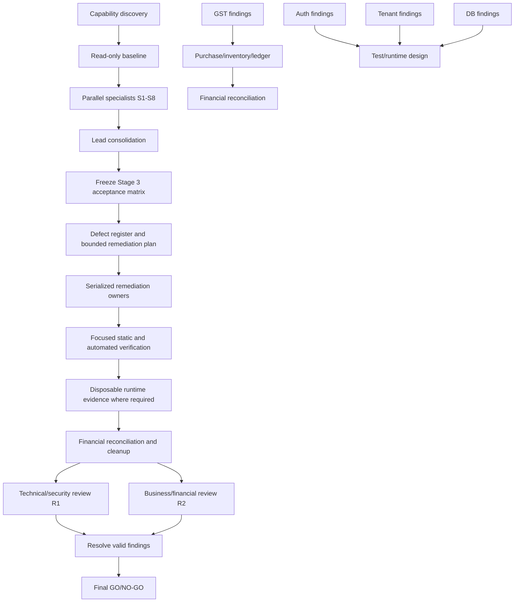

# Stage 3 — Final System Readiness & Engineering Acceptance

## 1. Capability discovery

| Capability | Available evidence | Limitation | Campaign implication |
|---|---|---|---|
| Lead orchestration | Current Copilot SDK session exposes direct tools, parallel tool wrapper, task agents, and task result retrieval | No observed Fleet-mode control plane | Lead coordinates waves and owns consolidation |
| Subagents | `functions.task` exposes `explore`, `task`, `general-purpose`, `code-review`, `rubber-duck`, and security/research profiles | Agent availability is runtime-dependent | Use bounded specialist waves; do not assume all agents succeed |
| Parallel execution | `multi_tool_use.parallel` and background task mode are available | Shared worktree means concurrent writes can conflict | Initial wave read-only; serialize all writes |
| Fleet mode | Not observed in the available tool surface | No fleet scheduler or fleet status API | Use explicit waves and dependency gates |
| Custom agent profiles | Built-in agent types are observed; no repository custom agent profile was found by glob | Do not create permanent profiles for this campaign | Use built-in roles with task contracts |
| Separate contexts | Background task agents return separate context histories | Findings must be explicitly consolidated | Require structured reports with source/evidence references |
| Shared worktree | All tools operate from `E:\PharmnosLite`; existing dirty state is visible | Agents can observe the same uncommitted changes | Preserve baseline; no overlapping write ownership |
| Agent delegation | Background agents can be launched and followed up with `read_agent`/`write_agent` | Earlier model-specific launches failed with HTTP 400; model is not controlled by this plan | Recover by sequential execution if a task fails |
| Plan mode | No separate plan-mode API observed | This document is the planning gate | Stop after plan approval request |
| Independent review | `code-review`/`rubber-duck` agents are available and can be kept outside implementation | Reviewers share filesystem but can be assigned read-only | Use two post-verification reviewers with distinct scopes |
| Browser/runtime | Playwright and terminal capabilities are available in the environment | No runtime should be started before approval | Reuse accepted invoice evidence; run only evidence-gap scenarios |

Repository instructions are present in `.github/copilot-instructions.md`, with canonical source `.obsidian-vault/CLAUDE.md`; no `AGENTS.md` file was found. The repository requires vault-only formal documentation, preservation of worktree state, no production/shared mutation, and explicit target-bound disposable runtime contracts.

## 2. Read-only system baseline

- Current branch and worktree are dirty with substantial pre-existing changes; those changes are preserved and are not a campaign baseline to reset.
- Stack: Next.js 14 App Router, TypeScript, Prisma PostgreSQL, Supabase Auth/Storage adapters, pnpm.
- Schema: tenant-owned PostgreSQL models for users, memberships, roles, purchases, sales, batches, stock movements, ledgers, payments, documents, GST governance, and inventory valuation.
- Migrations: `0001` through `0020`, including GST, payment integrity, inventory valuation history, invoice modernization, supplier documents, and RLS/active-document controls.
- Test organization: focused `.mjs` contracts, TypeScript GST tests, application acceptance scripts, target-contract/lifecycle tests, and invoice modernization contracts.
- Runtime infrastructure: disposable target-contract, provisioning, initialization, fixture lifecycle, application-hosted binding, and cleanup scripts exist. Production/shared execution is prohibited for this campaign.
- Accepted Stage 1/2 baseline: `.obsidian-vault/specs/invoice-runtime-acceptance/13-final-acceptance-report.md` records invoice modernization accepted at 100/100 within frozen scope. Reuse its target-bound browser, PDF, document, tenant-denial, reconciliation, and cleanup evidence; do not rerun without a demonstrated source/evidence gap.

## 3. Campaign objectives

The campaign must establish, with current-source evidence, whether the system is ready to proceed only to separately authorized Stage 4 migration planning:

1. Correct supported business workflows and state transitions.
2. Correct GST and supported non-GST calculations.
3. Reliable inventory, valuation, ledgers, and reconciliation.
4. Secure authentication, authorization, tenant isolation, and document access.
5. Consistent schema, constraints, migration compatibility, and rollback limitations.
6. Transaction atomicity, idempotency, correction, and retry safety.
7. Adequate automated/browser/runtime evidence.
8. Operational readiness, configuration separation, backup/recovery prerequisites, and observability.
9. No unresolved critical/high current-release defect that makes Stage 4 planning unsafe.

Deferred V2 features, statutory/professional determinations, production migration, and production release remain outside this campaign.

## 4. Workforce design

The initial workforce is eight read-only specialists, followed by one serialized remediation owner only when findings justify a fix, and two independent reviewers outside the implementation workforce.

| ID | Specialist role | Included scope | Excluded scope | Dependencies | Primary ownership | Mode/write |
|---|---|---|---|---|---|---|
| S1 | Architecture boundaries | App/domain/repository/adapters, data flow, duplication, boundary risks | No redesign or unrelated cleanup | None | `src/domain`, `src/repositories`, adapters | Parallel/read-only |
| S2 | Auth/session security | Auth adapter, cookies/tokens, protected actions, failure/revocation behavior | No production auth changes; no invented criterion | None | `src/adapters/auth`, `src/app/auth`, tenant context | Parallel/read-only |
| S3 | Authorization/tenant isolation | Permission checks, RLS contracts, tenant predicates, storage/document denial | No security downgrade or policy rewrite | None | `src/lib/db/tenant-context.ts`, RLS tests/scripts | Parallel/read-only |
| S4 | Database integrity/migrations | Prisma schema, constraints, indexes, migration order, data compatibility, rollback prerequisites | No migration execution against shared/production | None | `prisma/schema.prisma`, `prisma/migrations` | Parallel/read-only |
| S5 | GST/tax treatment | Purchase/sales GST, rounding, snapshots, discrepancy/revision, supported/non-supported boundaries | No statutory interpretation or policy invention | None | GST domain/services/actions/tests | Parallel/read-only |
| S6 | Purchase/inventory/ledger | Purchase finalization, receipt, batches, valuation, supplier ledger, correction/idempotency | No sales redesign; no new valuation policy | S5 informs GST interaction | purchase/inventory/ledger modules | Parallel/read-only |
| S7 | Sales/customer/documents | Sales finalization, FEFO, customer ledger, invoice/PDF/document lifecycle regression | Do not reopen accepted invoice work without evidence | Accepted Stage 1/2 baseline | sales/document modules | Parallel/read-only |
| S8 | Test/runtime/operations | Test gaps, target contracts, browser/runtime coverage, config, logging, backup/recovery, deployment readiness | No production/shared runtime; no broad rerun without gap | S1–S7 reports for gap selection | `tests`, `scripts`, config/docs | Parallel/read-only |
| R1 | Technical/security reviewer | Independent review of architecture, auth, tenant isolation, DB, migration, evidence | No implementation ownership | Final package only | Read-only entire package | Sequential after verification |
| R2 | Business/financial reviewer | Independent review of workflows, GST, inventory, ledgers, reconciliation, documents | No implementation ownership | Final package only | Read-only entire package | Sequential after R1 or parallel independent review |

### Write ownership rule

No specialist writes during the initial wave. After consolidation, one lead-selected remediation owner receives exclusive write ownership per file group. Critical files (`purchases.actions.ts`, `sales.actions.ts`, `inventory-valuation.actions.ts`, tenant context, Prisma schema/migrations, and shared test contracts) are never edited concurrently.

## 5. Dependency graph

## 6. Concurrency and recovery

- Maximum initial specialist concurrency: 8 read-only tasks, subject to runtime agent capacity.
- Initial wave: S1–S8 in parallel because their first-pass scopes are independent and non-mutating.
- Consolidation is sequential and lead-owned.
- Remediation is sequential by conflict group; unrelated low-risk fixes may be batched only after file ownership is explicit.
- Verification runs after all accepted remediation, not per-agent claims alone.
- If an agent fails, the lead records the failure and reassigns only that bounded scope sequentially; no duplicate parallel worker is launched for the same objective.
- If background agents are unavailable, execute the same task contracts sequentially with direct repository tools.
- Runtime evidence uses one exact disposable target contract and is authorized only after the plan and later runtime gate are approved.

## 7. Structured task contract

Every specialist report must contain:

1. Scope investigated.
2. Exact source/schema files inspected.
3. Observed behavior, separated from assumptions.
4. Reproduction/evidence method.
5. Defects with severity and impact.
6. Security/financial/data-integrity impact.
7. Existing test coverage and gaps.
8. Minimum correction, if any.
9. Dependencies/conflicts with other workstreams.
10. Confidence and unresolved questions.

No report may claim runtime or independent acceptance from static inspection alone.

## 8. Acceptance strategy

After investigation, freeze a new Stage 3 weighted matrix in `05-acceptance-matrix.md`; weights must total 100 and must not be changed after remediation starts. Credit states are: not inspected, investigated, implemented, static/test verified, runtime verified, independently reviewed, accepted. Only accepted criteria receive completion credit.

GO requires every mandatory criterion accepted, no unresolved critical/high blocker, current-release purchase/sales/GST/non-GST coverage where supported, accepted inventory/ledger reconciliation, documented migration and recovery prerequisites, sufficient runtime evidence, and acceptance by both R1 and R2. GO only authorizes Stage 4 planning; it does not authorize migration or release.

## 9. Planning challenge

- Covered: all requested workstreams A–P are mapped to S1–S8 without overlapping write authority.
- Consolidated rather than duplicated: purchase/inventory/ledger and sales/customer/document scopes are separated; security is split authentication from authorization.
- Missing-risk check: operational recovery, non-GST supported paths, migration compatibility, and configuration drift are explicitly assigned to S4/S8.
- Deferred-feature check: credit/debit notes, e-invoicing, returns beyond supported code, statutory ITC decisions, production migration, and release are not readiness credit unless already supported and required by frozen scope.
- Evidence sufficiency: prior accepted invoice evidence is reusable, but Stage 3 must add current-source system evidence and two independent reviews.
- Gate: this blueprint and the dispatch plan require owner approval before any broad specialist execution.

## 10. Safety boundaries

No production/shared database, hosted Supabase project, deployment, migration execution, destructive Git operation, staging, commit, push, branch switch, or security downgrade is authorized. Existing worktree changes remain untouched. Only exact campaign-created disposable resources may later be cleaned up.
